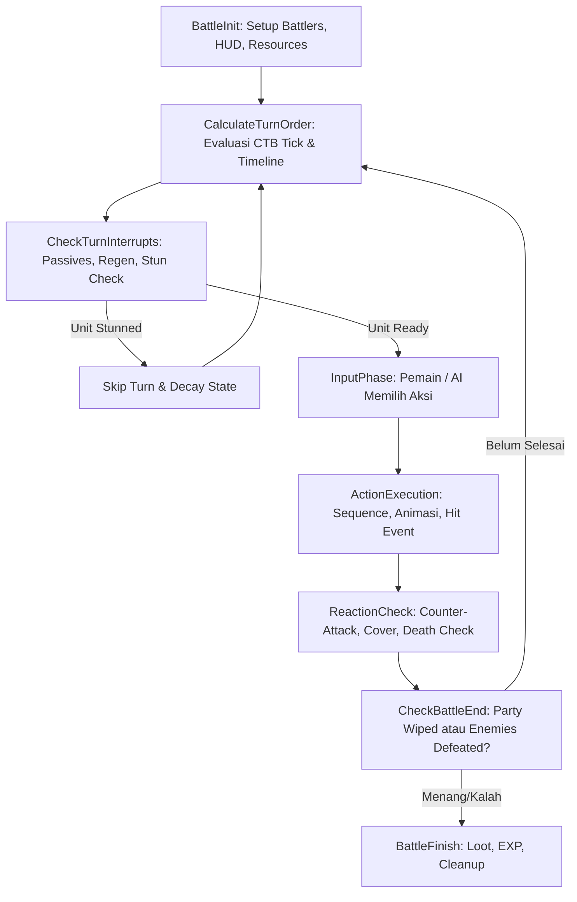

# Combat State Machine & Action Queues in Turn-Based RPGs

Dokumen ini membedah arsitektur State Machine, antrean giliran individual (CTB / Timeline Queue), serta penanganan interupsi aksi dalam game Turn-Based RPG.

---

## 1. Arsitektur State Machine & State Stack
Sistem pertarungan turn-based yang stabil memisahkan alur makro menjadi tahapan yang jelas:

### Mengapa State Stack Diperlukan?
Ketika serangan memicu reaksi mendadak (misalnya: *Counter Attack*, *Cover Ally*, atau *Death Throes*):
- Flat state machine sering mengalami bug karena state lama tertimpa sebelum animasi selesai.
- **State Stack (`push`/`pop`)**:
  1. `[ActionExecutionState]` sedang aktif.
  2. Musuh melakukan counter $\to$ push `[CounterAttackState]`.
  3. Setelah counter selesai, `[CounterAttackState]` di-pop.
  4. Eksekusi kembali ke `[ActionExecutionState]` untuk menyelesaikan follow-action tanpa kehilangan konteks.

---

## 2. Charge Turn Battle (CTB) / Timeline Action Queue
Berbeda dengan sistem giliran round-robin tradisional, CTB menghitung giliran berdasarkan kecepatan individu secara kontinu (*speed-driven timeline*).

### Formula Akumulasi CTB (Tick System)
Setiap tick simulasi, battler mengakumulasi *Charge Gauge* ($CG$):
$$CG_{baru} = CG_{lama} + (AGI \times SpeedModifier)$$

Ketika $CG \ge 1000$ (atau ambang batas penuh):
1. Battler memasuki antrean aksi (`ReadyToAct`).
2. Battler dengan overflow $CG$ tertinggi dieksekusi terlebih dahulu.
3. Setelah mengeksekusi jurus, $CG$ direset ke 0 (atau dikurangi sesuai *Action Delay Cost* dari skill yang digunakan).

### Aturan Balancing CTB:
1. **Action Delay / Recovery Cost**:
   - Skill cepat (misal: *Quick Strike*) hanya menggunakan 600 $CG$, memungkinkan karakter segera bertindak lagi.
   - Skill pamungkas (misal: *Meteor*) membebankan penalti 1400 $CG$, mendorong giliran karakter jauh ke belakang antrean.
2. **Speed Capping & Diminishing Returns**:
   - Jika AGI karakter terlalu tinggi tanpa batas, karakter bisa mengambil 10 giliran sebelum musuh bertindak 1 kali (*infinite speed-lock*).
   - Selalu terapkan *soft-cap* atau kurva logaritmik pada konversi AGI ke tick CTB.
3. **Turn Order Prediction**:
   - Tampilkan minimal 5 ikon antrean giliran mendatang pada HUD.
   - Setiap kali pemain mengarahkan kursor ke skill dengan penalti delay tinggi, HUD timeline harus mempratinjau (*preview*) pergeseran posisi giliran karakter tersebut.

