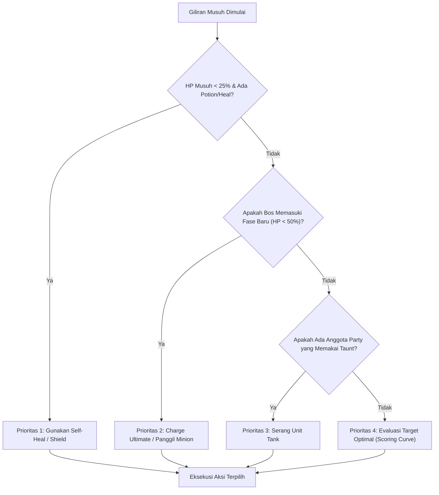

# Turn-Based AI & Combat Balancing

Dokumen ini mendokumentasikan prinsip rekayasa kecerdasan buatan (Enemy AI), formula penargetan taktis, evaluasi metrik Time-To-Kill (TTK), dan pencegahan dominansi strategi tunggal (*alpha-striking*) dalam game Turn-Based RPG.

---

## 1. Arsitektur Enemy AI (Behavior & Decision Trees)

AI musuh dalam RPG turn-based harus menghadirkan tantangan taktis yang adil, bukan pemilihan skill acak (*pure random*) atau perilaku tidak masuk akal (seperti musuh sekarat memakai buff alih-alih menyerang/kabur).

### Model Pengambilan Keputusan (Utility & Priority AI)
Musuh mengevaluasi kondisi medan perang menggunakan pohon prioritas terstruktur:

### Formula Penargetan Cerdas (Target Scoring):
Untuk setiap karakter pemain, AI menghitung skor ancaman (*Threat Score*):
$$\text{Score} = (\text{Base Aggro}) + (2.0 \times \text{Weakness Exploit}) + (1.5 \times \text{Lowest HP \%}) - (1.0 \times \text{High DEF})$$
- Musuh tipe **Assassin**: Mengincar target ber-HP terendah atau spellcaster rapuh di baris belakang.
- Musuh tipe **Brute**: Menyerang target dengan armor tertinggi atau yang memicu Provoke.
- Musuh tipe **Mage**: Memilih target yang memiliki kelemahan elemen terhadap mantranya.

---

## 2. Metrik Penyeimbangan Pertempuran (Combat Balancing Metrics)

### A. Metrik Time-To-Kill (TTK)
Time-To-Kill adalah jumlah giliran rata-rata yang dibutuhkan satu unit untuk mengalahkan lawannya.

| Kategori Encounter | Target TTK Pemain ke Musuh | Target TTK Musuh ke Pemain | Karakteristik Gameplay |
| :--- | :--- | :--- | :--- |
| **Normal Mob (Grunt)** | 2 – 3 Giliran | 5 – 7 Giliran | Cepat, memuaskan, fokus pada penghematan resource (HP/MP/SP). |
| **Elite / Mini-Boss** | 5 – 8 Giliran | 3 – 4 Giliran | Wajib menggunakan mekanik debuff, crowd control, dan exploit elemen. |
| **Major Boss (Story)** | 12 – 20 Giliran | 2 – 3 Giliran (jika salah taktik) | Multi-fase, ada telegrafi ultimate, membutuhkan rotasi tank/healer/DPS. |

### B. Mencegah "Alpha-Striking" (Pemain Menyapu Bersih Musuh di Giliran 1)
Jika pemain bisa menghabisi seluruh musuh sebelum musuh sempat bertindak:
1. **Initial SP/TP Gating**: Jurus AoE berkekuatan tinggi membutuhkan akumulasi SP yang diperoleh selama pertarungan, bukan tersedia gratis di detik pertama (seperti sistem SP Nusvanir).
2. **Ambush & Enemy Initiative**: Musuh tertentu memiliki passives inisiatif tinggi yang memaksa pemain bereaksi secara defensif di putaran pembuka.
3. **Shield Gate / Damage Cap**: Bos memiliki *damage cap* per serangan atau pelindung fase yang mencegah *one-shot kill*.

### C. Telegrafi Serangan Mematikan (Telegraphed Ultimates)
Serangan berdaya rusak sangat tinggi (bisa membunuh karakter dalam 1 hit) **WAJIB diberi telegrafi 1 giliran sebelumnya**:
- *Giliran 1*: Bos mengambil pose "Charging Dark Pulse...", memunculkan lingkaran sihir visual dan status peringatan.
- *Giliran Pemain*: Pemain diberi kesempatan untuk:
  - Mengambil aksi *Guard* (mengurangi damage 50%).
  - Menggunakan skill *Stun/Interrupt* untuk menggagalkan casting.
  - Memasang *Shield/Barrier* pada anggota tim yang rentan.
- *Giliran 2*: Bos melancarkan jurus pamungkas.

