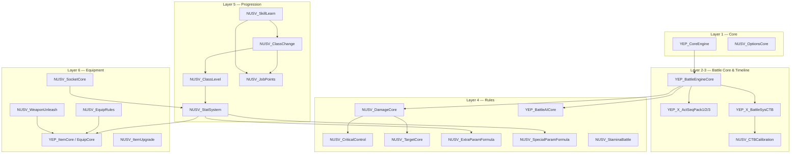
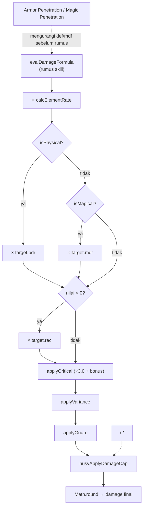
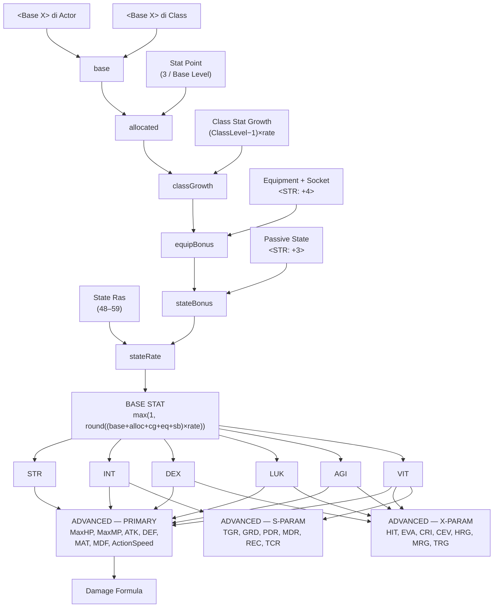
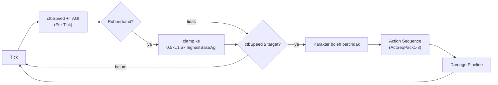
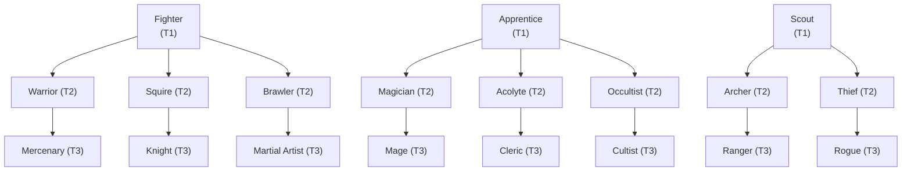
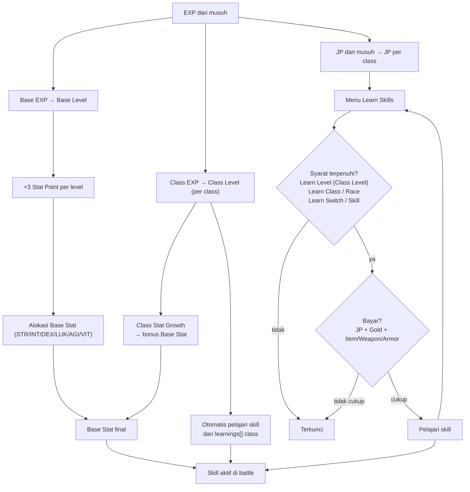
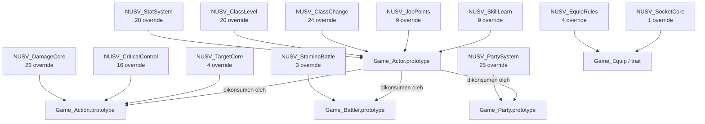
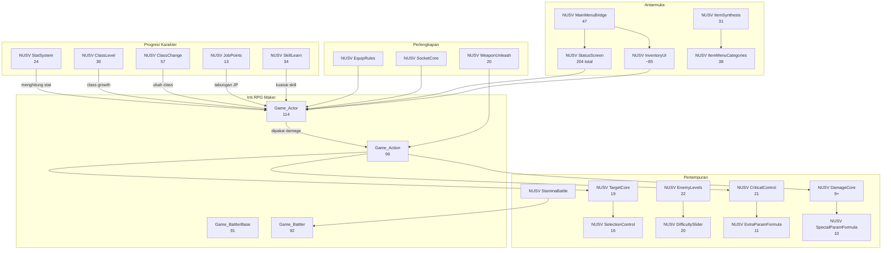

# Analisis Sistem Game — *Tales of The Dark Time* (Nusvanir)

> Dokumen ini adalah penjelasan **bahasa Indonesia** dari hasil analisis knowledge graph
> (`graphify-out/`) atas repository ini, diperbarui dengan pembacaan langsung kode sumber.
> Semua angka/formula di bawah **diambil dari kode yang benar-benar berjalan**, bukan dari
> asumsi desain.
>
> * Sumber utama: `js/plugins/NUSV_*.js`, `js/plugins/YEP_*.js`, `data/*.json`
> * Graf pengetahuan: `graphify-out/graph.json`, `graphify-out/GRAPH_REPORT.md`, `graphify-out/graph.html`

---

## Daftar Isi

1. [Sekilas Arsitektur](#1-sekilas-arsitektur)
2. [Battle System](#2-battle-system)
3. [Stat System](#3-stat-system)
4. [Base Stat vs Advanced Stat](#4-base-stat-vs-advanced-stat)
5. [Race](#5-race)
6. [Class](#6-class)
7. [Actor](#7-actor)
8. [Skill Learn](#8-skill-learn)
9. [Bagan/Diagram](#9-bagan-diagram)
10. [Knowledge Graph (Graphify)](#10-knowledge-graph-graphify)
11. [Cheat Sheet Formula](#11-cheat-sheet-formula)
12. [Referensi File](#12-referensi-file)

---

## 1. Sekilas Arsitektur

Game ini **bukan** RPG Maker MV polos. Ada **77 entri plugin terdaftar, 67 aktif**, dengan dua
"lapisan" yang saling menimpa:

> 📌 `DOCUMENTATION.md` menyebut "65 plugin aktif" — angka itu **sudah usang**.
> Verifikasi langsung di `js/plugins.js` (via `json.loads` atas `$plugins`) menghasilkan
> **67 plugin berstatus `true`** dari 77 entri. Selalu verifikasi angka statistik dari
> sumbernya, bukan dari dokumentasi.

| Lapisan | Peran | Contoh |
|---|---|---|
| **Yanfly (YEP_)** | Fondasi battle engine RPG Maker MV | `YEP_BattleEngineCore`, `YEP_X_BattleSysCTB`, `YEP_X_ActSeqPack1-3`, `YEP_BattleAICore`, `YEP_ItemCore`, `YEP_EquipCore`, `YEP_MainMenuManager` |
| **NUSV_ (custom)** | Aturan Nusvanir di atas fondasi itu | `NUSV_StatSystem`, `NUSV_ClassLevel`, `NUSV_DamageCore`, `NUSV_CriticalControl`, `NUSV_SkillLearn`, `NUSV_ClassChange`, `NUSV_JobPoints`, `NUSV_EquipRules`, `NUSV_TargetCore` |

Semua plugin `NUSV_*` ditulis **clean-room** (dari nol, bukan fork dari Yanfly) — ini terlihat
dari header komentar tiap file: *"It does NOT contain or copy YEP_XXX source code."*

```
Layer 1  Core        YEP_CoreEngine, NUSV_OptionsCore
Layer 2  Battle Core YEP_BattleEngineCore, YEP_X_ActSeqPack1/2/3
Layer 3  Timeline    YEP_X_BattleSysCTB  →  NUSV_CTBCalibration (visual)
Layer 4  Rules       NUSV_DamageCore, NUSV_CriticalControl, NUSV_TargetCore,
                     NUSV_ExtraParamFormula, NUSV_SpecialParamFormula,
                     YEP_BattleAICore, NUSV_StaminaBattle
Layer 5  Progression NUSV_StatSystem, NUSV_ClassLevel, NUSV_JobPoints,
                     NUSV_ClassChange, NUSV_SkillLearn
Layer 6  Equipment   YEP_ItemCore/EquipCore, NUSV_EquipRules, NUSV_SocketCore,
                     NUSV_ItemUpgrade, NUSV_WeaponUnleash
Layer 7  UI          YEP_MainMenuManager, NUSV_StatusScreen, NUSV_PartySystem,
                     NUSV_MainMenuBridge, NUSV_MapSelect*
```

> **Implikasi penting:** urutan plugin di `js/plugins.js` menentukan siapa yang menimpa siapa.
> Contoh: `NUSV_ExtraParamFormula` berjalan **setelah** `NUSV_StatSystem`, sehingga
> `HIT/EVA/CRI` final bisa **melewati batas cap** yang ditetapkan StatSystem (lihat §4.4).

---

## 2. Battle System

### 2.1 Timeline CTB (Charge Turn Battle)

Bukan turn-based klasik. Setiap小额 tick, semua pihak menambah "kecepatan aksi"
(`ctbSpeed`). Ketika `ctbSpeed` mencapai `ctbTarget()`, karakter itu **boleh bertindak**.

Parameter aktual (`js/plugins.js` → `YEP_X_BattleSysCTB`):

| Parameter | Nilai | Arti |
|---|---|---|
| `Per Tick` | `user.agi` | Tiap tick, kecepatan += AGI karakter |
| `Initial Speed` | `0` | Semua mulai dari 0 (gaya race) |
| `Full Gauge` | `Math.max(7000, BattleManager.highestBaseAgi() * 120)` | Target untuk satu aksi |
| `Full Turn` | `Math.min(200, BattleManager.lowestBaseAgi() * 8)` | Batas "1 turn" |
| `Minimum Speed` | `0.5 * highestBaseAgi()` | Rubberband bawah |
| `Maximum Speed` | `1.5 * highestBaseAgi()` | Rubberband atas |
| `Enable Rubberband` | `true` | Aktif |
| `Show Turn Order` | `true` | Bar antrean giliran ditampilkan |

Konsekuensi desain:

* **AGI = kecepatan ticks.** 1 poin AGI = 1 poin kecepatan per tick. Seseorang dengan AGI 20
  butuh `7000/20 = 350 tick` untuk satu aksi.
* **Rubberband aktif** → speed di-clamp ke `[0.5×, 1.5×]` AGI tertinggi. Efeknya: karakter
  AGI rendah tidak bisa selamanya tertinggal, tapi juga tidak bisa mendominasi. Yang
  terlemah bisa "sepatah" dengan yang terkuat.
* **Full Turn = `min(200, lowestBaseAgi × 8)`** →_window_ satu giliran. Kalau AGI terendah 12,
  satu turn = 96 tick. Artinya karakter bereaksi dalam rentang **±(1 turn)**.

`NUSV_CTBCalibration` murni visual: fallback icon musuh yang tidak punya battler statis,
pemotongan wajah (face crop) pada ikon antrean, dan font huruf penanda musuh jamak (A/B/C).

### 2.2 Antrean Aksi & Alur Pertempuran

```
BattleManager
 ├─ makeRewards()      → EXP biasa + EXP Class (NUSV_ClassLevel) + JP (NUSV_JobPoints)
 ├─ gainRewards()      → distribute JP ke party yang hidup
 ├─ createFinishActions() → aksi penutup (NUSV_DamageCore)
 ├─ processActionSequence(name, args)  → eksekusi action sequence Yanfly
 └─ endAction() → endBattle(result)
```

Urutan：**CTB speed tick** → karakter siap → **pilih aksi** → `action sequence`
(`YEP_X_ActSeqPack1-3`) → **damage pipeline** → popup → kembali ke tick.

### 2.3 Damage Pipeline (urutan eksekusi)

`NUSV_DamageCore.makeDamageValue()` menyalin ulang alur MV supaya **capApplied di tahap
akhir**, setelah guard & variance:

```
1. evalDamageFormula(target)      → rumus skill (atau <Damage Formula> custom)
2. × calcElementRate(target)       → pengali elemental (YEP_ElementCore)
3. × target.pdr / target.mdr       → Physical/Magical Damage Rate
4. × target.rec  (jika nilai < 0)  → Recovery Rate
5. applyCritical()                 → kritikal (lihat §2.4)
6. applyVariance()                 → variance skill (±v%)
7. applyGuard()                    → efek Guard
8. nusvApplyDamageCap()            → plafon damage/heal
9. Math.round()                    → pembulatan akhir
```

**Penetrasi:** `nusvDef(t)` = `t.def × (1 − armorPenetration)` dan
`nusvMdf(t)` = `t.mdf × (1 − magicPenetration)`. Tag `<Armor Penetration>` dan
`<Magic Penetration>` dijumlahkan dari skill, equipment, dan trait.

**Plafon (Cap):**
* `<Damage Cap: N>` / `<Heal Cap: N>` per skill/equipment.
* Bisa di-bypass dengan `<Bypass Damage Cap>`.
* Default global diatur di parameter plugin `NUSV_DamageCore`.

### 2.4 Kritis

| Aspek | Nilai |
|---|---|
| Pengali default | **×3.0** (standar MV) |
| Bonus kritis | `<Critical Damage: +25%>` → **×3.25** (adder ke pengali) |
| Sumber bonus | skill, equipment, trait dijumlahkan (`sumPercentTag`) |
| Plugin | `NUSV_CriticalControl` (default global `value *= 3.0 + bonus`) |

> ⚠️ **Catatan akurasi:** skill `nusvanir-combat-stats` menyebut pengali kritis default 1.5.
> Yang benar di kode (`NUSV_DamageCore.applyCritical`) adalah **3.0** — pengali 1.5 ada di
> `NUSV_StatSystem` sebagai `BASE_CRIT_DMG` untuk **CDMG** (stat turunan), bukan untuk
> pengali damage kritis saat serangan.

### 2.5 Targeting

`NUSV_TargetCore` memperluas targeting MV:

* `<Target Tag>` → kumpulan target spesifik
* `<Custom Target Eval>` → target ditentukan via eval JS
* Mode: single / all enemies / all allies / caster / random / terfilter tag

`NUSV_SelectionControl` menangani UI pemilihan target (sorot, konfirmasi, info target).

### 2.6 AI Musuh

Lapisan: `YEP_BattleAICore` (mesin `<AI Priority>`) + `NUSV_EnemyLevels` + `NUSV_DifficultySlider`.

Format `<AI Priority>`:

```
<AI Priority>
HP% <= 40%: Fleeing Scratch, Lowest HP%
Turn 2+: Wing Flap, Random
Always: Peck, Highest TGR
</AI Priority>
```

* **`Highest TGR` / `Lowest TGR`** → memilih target dengan **Target Rate** tertinggi.
  TGR adalah parameter S khusus (`NUSV_SpecialParamFormula`) yang menyatakan
  "seberapa besar peluang karakter ini jadi sasaran".
* **`Highest MAT`** → target dengan M.ATK tertinggi (murni output).
* **56 dari 81 musuh** di `data/Enemies.json` memakai `TGR` di AI Priority — jadi TGR
  adalah pillar utama perilaku musuh, bukan pelengkap.
* Syarat kondisi AI: HP%, MP%, level party, HP/MP party, element, switch, variable, turn,
  dan `Eval` (JS bebas).

### 2.7 SP (Stamina) di Pertempuran

`NUSV_StaminaBattle` menjadikan SP sebagai sumber daya tempur:

| Situasi | Rumus |
|---|---|
| **Guard/Defend** | `Max SP × (0.15 + TRG × 2)` — minimal 1 SP |
| **Kena serangan** | `Max SP × (damageRate × 0.5 × endurance × regenScale × TCR)` |
| `endurance` | `1.0 + max(0, (VIT − 10) × 0.015)` |
| `regenScale` | `1.0 + TRG × 5` |
| `damageRate` | fraksi HP yang hilang |

Jadi **berhenti guard = pulih SP cepat**, dan **dipukul = SP naik** (adrenaline). SP bukan
sekadar "HP kedua", tapi sumber daya taktik yang bisa dibelanjakan (mis. skill bertanda
`SP Cost`).

> 🔍 **Temuan dari data:** saat ini **tidak ada satu pun dari 441 skill** yang memakai
> `spCost` (field `spCost` = 0 untuk semua skill, dan tidak ada notetag `SP Cost`).
> Yang ada justru **123 skill dengan `mpCost > 0`**. Artinya SP sekarang berfungsi
> sebagai **akumulator/pemulih**, belum sebagai **mata uang yang dibelanjakan**.
> Sistemnya sudah siap (guard recovery + on-hit adrenaline + Max SP dari VIT/STR +
> `TCR` di `NUSV_SpecialParamFormula`), tapi belum ada skill yang mengonsumsinya —
> ini celah desain yang paling jelas terlihat dari data.

### 2.8 Scaling Musuh & Difficulty

* **`NUSV_EnemyLevels`** — level musuh per enemy (`<Enemy Level: 10>`, `5 to 12`, `Party`),
  plus `<Enemy Level Formula>` untuk level dinamis. `Use Party Level` dengan mode
  average/highest/lowest.
* **`NUSV_DifficultySlider`** — 4 preset (Easy/Normal/Hard/Nightmare), masing-masing punya
  **Param Rate** (parameter musuh), **EXP Rate**, **Gold Rate**. Preset bisa diubah runtime
  lewat `ConfigManager` dan bisa di-override per-musuh lewat `<Difficulty Param Rate>`.

---

## 3. Stat System

### 3.1 Enam Base Stat

| Stat | Nama | Arti |
|---|---|---|
| **STR** | Strength | Damage melee, Max HP, Max SP, DEF |
| **INT** | Intelligence | M.ATK, Max MP, M.DEF, MP regen |
| **DEX** | Dexterity | Akurasi (HIT), kritikal rate, ATK jarak/finesse |
| **LUK** | Luck | Evasi, kritikal rate, Critical Evasion |
| **AGI** | Agility | Kecepatan aksi (CTB), Evasi, TRG |
| **VIT** | Vitality | Max HP, DEF, M.DEF, Max SP, TGR |

Enam stat ini **bukan** parameter MV bawaan. `NUSV_StatSystem` mendefinisikan getter
`str/int/dex/luk/agi/vit` pada `Game_Actor` yang memanggil `nusvBaseStat(key)`.

### 3.2 Stat Point (Alokasi Pemain)

* Setiap naik **1 Base Level** pemain dapat **3 Stat Point** (param `Points Per Base Level`, default 3).
* Poin awal saat karakter dibuat: `(baseLevel − 1) × 3`.
* Tersimpan di `actor._nusvStatPoints`; status screen (`NUSV_StatusScreen`) menampilkan
  "Base Stats (+N Pts)" dan menyediakan UI alokasi.
* `<Reset Stat Points>` (item) mengembalikan 100% poin.
* `gainStatPoints(n)` untuk bonus dari item/event.

> **Penting:** Stat Point **tidak hilang** saat ganti class. Yang hilang adalah **Class Level**
> (lihat §6).

### 3.3 Base Stat — Rantai Perhitungan

Ini adalah inti Stat System. `nusvBaseStat(statKey)` menghitung:

```
baseStat = max(1, round( (base + allocated + classGrowth + equipBonus + stateBonus) × stateRate ))
```

| Komponen | Sumber |
|---|---|
| `base` | `<Base STR: N>` di **actor** (dipakai kalau > 0), lalu ditimpa `<Base STR: N>` di **class**. Default **10**. |
| `allocated` | Stat Point yang dialokasi pemain |
| `classGrowth` | `nusvClassStatBonus()` dari `NUSV_ClassLevel` = `round((ClassLevel − 1) × growthRate)` |
| `equipBonus` | Tag equipment (`<STR: +4>`) **termasuk item yang disocket** (`NUSV_SocketCore`) |
| `stateBonus` | Tag state (`<STR: +3>`) |
| `stateRate` | Perkalian semua `<STR Rate: X>` dari state — **ini pembawa modifier ras** |

> **Catatan urutan:** `base` dari **class menimpa** `base` dari actor, bukan ditambah.
> Jadi `<Base DEX: 12>` pada actor Hector (class Paladin) ditimpa `<Base DEX: 4>` Paladin.

### 3.4 Derived Stat (Parameter Utama, param 0..7)

`paramBase()` di-override; `paramPlus()` bawaan MV tetap dipakai (equipment/class traits).

| Param | Nama | Rumus |
|---|---|---|
| 0 | Max HP | `classBase + VIT×15 + STR×5` |
| 1 | Max MP | `classBase + INT×8` |
| 2 | ATK (melee) | `classBase + STR×2 + DEX×0.5` |
| 2 | ATK (finesse/ranged) | `classBase + DEX×2 + STR×0.5` |
| 3 | DEF | `classBase + VIT×1.5 + STR×0.5` |
| 4 | MAT | `classBase + INT×2` |
| 5 | MDF | `classBase + INT×1.2 + VIT×0.8` |
| 6 | Action Speed | `classBase + AGI×1.5 + equipmentFlat` |
| 7 | LUK (param MV) | `classBase + LUK` |

**ATK bersifat dinamis:** `isFinesseWeaponUser()` benar bila ada senjata ber-`wtypeId`
8 (Long Bow), 9 (Crossbow), 10 (Dagger), atau bertag `<Finesse>` / `<Ranged>`. Artinya
**senjata jarak atas nama switch seluruh rumus ATK karakter** — Scout/Archer/Sniper otomatis
mendapat benefit DEX, dan begitu juga Fighter yang memakai busur.

Max SP (bukan parameter MV,Diatur terpisah):

```
Max SP = max(10, round(50 + VIT×5 + STR×2 + flatBonus))
```

`flatBonus` dari equipment (`<Max SP: +10>`) dan state. Lihat juga §2.7.

### 3.5 X-Parameter (Stat Akurasi/Kritis/Regen)

`xparam()` di-override:

| ID | Nama | Rumus | Cap |
|---|---|---|---|
| 0 | **HIT** | `0.85 + DEX×0.002` + equipment | **1.00** (100%) |
| 1 | **EVA** | `0.02 + AGI×0.002 + LUK×0.0005` + equipment | **0.80** (80%) |
| 2 | **CRI** | `0.03 + DEX×0.002 + LUK×0.001` + equipment | **0.85** (85%) |
| 3 | **CEV** | `LUK×0.0015 + VIT×0.001` + equipment | — |
| 7 | **HRG** | `VIT×0.0003` + equipment | — |
| 8 | **MRG** | `INT×0.0003` + equipment | — |
| 9 | **TRG** | `0.03 + AGI×0.0004 + VIT×0.0002` + equipment | — |

### 3.6 S-Parameter (Stat Pertahanan & Rate)

`sparam()` di-override:

| ID | Nama | Arti |
|---|---|---|
| 0 | **TGR** | Target Rate — peluang jadi sasaran musuh |
| 1 | **GRD** | Guard Effect Rate — efektivitas Guard |
| 2 | **REC** | Recovery Effect Rate — efektivitas heal |
| 3 | **PHA** | Pharmacology — efektivitas item/obat |
| 4 | **MCR** | MP Cost Rate — pengali konsumsi MP |
| 5 | **TCR** | TP Charge Rate — kecepatan-charging SP |
| 6 | **PDR** | Physical Damage Rate — pengali damage fisik diterima |
| 7 | **MDR** | Magical Damage Rate |
| 8 | **FDR** | Floor Damage Rate |
| 9 | **EXR** | Experience Rate |

---

## 4. Base Stat vs Advanced Stat

Ini dua konsep yang berbeda, dan memang sering tertukar.

### 4.1 Base Stat (Stat Dasar)

**Definisi:** enam angka inti yang bisa **dialokasi pemain** (STR/INT/DEX/LUK/AGI/VIT).
Sifatnya:

* Wuril dariactor/class + alokasi Stat Point + growth class + equipment + state.
* **Selalu positif** (`min 1`).
* **Dapat dipengaruhi ras** lewat pengali `<X Rate: X>` (lihat §5).
* Ditampilkan di layar Status sebagai blok "Base Stats (+N Pts)".

### 4.2 Advanced Stat (Stat Lanjutan / Turunan)

**Definisi:** semua angka lain yang **dihitung otomatis** dari Base Stat + equipment +
state. Tidak bisa dialokasi langsung; hanya bisa diubah lewat equipment, passive state,
class ability, atau efek status.

Advanced Stat terbagi tiga kelompok:

| Kelompok | Isi | Sumber |
|---|---|---|
| **Primary** (param 0..7) | Max HP, Max MP, ATK, DEF, MAT, MDF, Action Speed, LUK | `NUSV_StatSystem.paramBase` |
| **X-Parameter** | HIT, EVA, CRI, CEV, MEV, MRF, CNT, HRG, MRG, TRG | `NUSV_StatSystem.xparam` + `NUSV_ExtraParamFormula` |
| **S-Parameter** | TGR, GRD, REC, PHA, MCR, TCR, PDR, MDR, FDR, EXR | `NUSV_StatSystem.sparam` + `NUSV_SpecialParamFormula` |

### 4.3 Relasi Keduanya

```
                       ┌─────────────────────────────┐
                       │  BASE STAT (6 angka)        │
                       │  STR INT DEX LUK AGI VIT    │
                       └──────────────┬──────────────┘
                                      │
        ┌─────────────────────────────┼─────────────────────────────┐
        │                             │                             │
        ▼                             ▼                             ▼
 ┌──────────────┐            ┌──────────────────┐          ┌──────────────────┐
 │  PRIMARY     │            │  X-PARAMETER     │          │  S-PARAMETER     │
 │  MaxHP/ATK/  │            │  HIT/EVA/CRI/    │          │  TGR/GRD/PDR/    │
 │  DEF/MAT/... │            │  CEV/HRG/MRG/    │          │  MDR/REC/...     │
 └──────┬───────┘            │  TRG             │          └──────────────────┘
        │                    └──────────────────┘
        ▼                              ▲
 ┌──────────────┐                     │
 │  BATTLE FORM │─────────────────────┘
 │  damage      │
 └──────────────┘
```

Contoh konversi (Fighter, class base STR 4, tanpa equipment):

* Base STR = `10` (default; class `<Base STR: 4>` → 4) + alokasi
* ATK melee = `classBaseATK + STR×2 + DEX×0.5`
* Max HP = `classBaseHP + VIT×15 + STR×5`
* HIT = `0.85 + DEX×0.002` → sudah 85% tanpa investment DEX apa pun

### 4.4 ⚠️ Peringatan: Cap Bisa Dilanggar

`NUSV_StatSystem` memasang cap (HIT ≤ 100%, EVA ≤ 80%, CRI ≤ 85%). Tapi
**`NUSV_ExtraParamFormula` berjalan setelahnya** dan menerapkan:

* `<HIT Plus: +5%>` / `<EVA Plus>` / `<CRI Plus>` (adder)
* `<HIT Rate: 110%>` (multiplier)
* `<HIT Formula> ... </HIT Formula>` (rumus JS bebas, variabel `base, user, a, s, v`)

Nilai akhirnya **tidak di-cap ulang**. Artinya equipment/status dengan `<CRI Plus: +20%>`
bisa mendorong CRI melewati 85%. Ini disengaja (design fleksibel), tapi berarti
**nilai yang tampil di layar Status bisa berbeda dari cap teoretis**.

Selain itu `NUSV_SpecialParamFormula` menyediakan override global untuk
TGR/GRD/REC/PHA/MCR/TCR/PDR/MDR/FDR/EXR dengan variabel sama.

---

## 5. Race (Ras)

### 5.1 Mekanisme

Race **bukan** stat terpisah — race adalah **passive state** yang otomatis dipasang ke
aktor, dan pengaruhnya masuk lewat tag `<X Rate: X>`:

```
data/Races.json  →  { name, stateId, modifiers, natureTags }
                         │
                         ▼
data/States.json  →  State #48..59  (satu state per ras)
                   tag: <STR Rate: 1.1>, <Race: Pribumi>, ...
                         │
                         ▼
NUSV_StatSystem.nusvBaseStat()  →  stateRate *= rVal  →  hasil base stat dikali
```

`Game_Actor.nusvRaceState()` mencari state yang cocok lewat tag `<Race: ...>` atau nama
`"Ras: <nama>"`. State ras **tidak bisa dilepas** selama karakter hidup (dieksklusif
dari `allIcons`/remove), jadi modifier ras bersifat permanen.

> **Redundansi yang perlu diwaspadai:** modifier ras **duplikat** di dua tempat —
> `data/Races.json` (field `modifiers`) **dan** tag `<X Rate: X>` di `data/States.json`.
> `editor_studio/js/editors/race_editor.js` memiliki `updateRaceStateSync()` yang
> menyinkronkan keduanya — jadi **edit lewat Database Studio, jangan edit JSON manual**,
> atau keduanya akan menyimpang.

### 5.2 Tabel 12 Ras

`+` = +10%, `−` = −10%, `=` = netral.

| ID | Ras | STR | INT | DEX | LUK | AGI | VIT | Ciri |
|---|---|---|---|---|---|---|---|---|
| 1 | **Pribumi** | = | = | = | = | = | = | Manusia fana, paling adaptif — netral di semua stat |
| 2 | **Wahanarsa** | − | + | + | = | = | − | Bangsawan terpelajar: sihir & taktik, fisik dimanjakan |
| 3 | **Asrivana** | − | + | = | = | + | − | Elf pelindung Hutan Suci: sihir alam + akrobatik |
| 4 | **Avesari** | = | + | = | − | − | + | Keturunan cahaya suci: ketahanan spiritual, gaya ortodoks |
| 5 | **Butoraksa** | + | − | − | = | = | + | Raksasa Gua Garbhagiri: otot luar biasa, enggan akademis |
| 6 | **Garuda** | − | = | + | = | + | − | Manusia burung Nusa Sayendra: langit & kecepatan |
| 7 | **Hanorok** | − | = | + | = | + | − | Beastmen kera: penyergapan & kombo kilat |
| 8 | **Nagarasven** | + | + | = | − | − | = | Reptil purba: sisik karang & nafas api |
| 9 | **Rakshorien** | − | + | = | + | = | − | Elf buangan Gua Wisamaya: sihir bayangan & cakar beracun |
| 10 | **Troliogoro** | = | = | + | − | − | + | Pandai besi Agnigarba: kulit logam, serakah emas |
| 11 | **Dewantara** | + | + | − | − | = | = | Ksatria suci Avalerion: disiplin militer |
| 12 | **Bhuta** | + | = | − | + | = | − | Iblis elit Raksamala: terror & energi kegelapan |

### 5.3 Analisis Desain Ras

* **Pribumi = netral** → pilihan "aman" untuk pemain yang belum tahu build.
* **Tiga ras "dedikasi"** denganArchiveduan jelas:
  * **Fisik/tahan banting**: Butoraksa, Nagarasven, Dewantara, Troliogoro (STR/VIT +)
  * **Sihir/akademik**: Wahanarsa, Asrivana, Rakshorien (INT +)
  * **Kecepatan/akurasi**: Garuda, Hanorok (DEX/AGI +, LUK −)
* **Counter-ras tersembunyi:** *Avesari* (suci, INT+/VIT+/LUK−) vs *Bhuta* (iblis,
  STR+/LUK+). Keduanya −10% LUK tapi/+10% LUK →/+ STR. Ini disetel sebagai **mirror matchup**.
* **LUK −** muncul pada semua ras yang AGI/DEX tinggi (Garuda, Hanorok, Nagarasven,
  Troliogoro, Dewantara) → kompensasi agar AGI/DEX tidak mendominasiCRI & CEV sekaligus.
* Tidak ada ras dengan modifier > 10% → **balance maximum 10% per stat**, jadi
  pilihan ras tidak bolehPTO lebih dari ~10% swing per stat.

---

## 6. Class (Profesi)

### 6.1 Dual Level System

`NUSV_ClassLevel` introduce dua level yang berjalan bersamaan:

| | **Base Level** | **Class Level** |
|---|---|---|
| Sumber EXP | Base EXP (level karakter) | Class EXP (per-profesi) |
| Dipengaruhi class? | ❌ tidak | ✅ ya |
| Saat ganti class | ✅ **tetap** | ❌ **reset ke level 1 class baru** |
|lyl awards | 3 Stat Point per level | Class Stat Growth + buka skill |
| Dipakai untuk | Equipment, area access, HP/MP | Learnings class, JP per class |

> **Aturan emas:** ganti class **tidak** menurunkan Base Level, jadi Stat Point
> (dan alokasi stat) **tidak hilang**. Yang hilang adalah Class Level — dan dengan itu
> bonus stat dari `<Class Stat Growth>`.

### 6.2 Batas Level per Tier

| Tier | Max Class Level |
|---|---|
| Tier 1 | 10 |
| Tier 2 | 30 |
| Tier 3 | 40 |
| Tier 4 | 50 |
| Tier 5 | 60 |
| Tier 6 | 70 (override `<Class Max Level: 70>`) |

Default dibaca dari parameter plugin (`Tier N Max Level`), dan **bisa di-override per class**
dengan `<Class Max Level: N>`.

### 6.3 Rumus Class EXP

```
classExpForLevel(level) = round(35 × (level − 1)^1.65)
```

Lengkung eksponensial moderat. Contoh:
* Lv 1→2: 35 EXP
* Lv 10→11: `35 × 9^1.65` ≈ 1.290 EXP
* Lv 30→31: `35 × 29^1.65` ≈ 12.770 EXP

Class EXP didapat dari **`total` JP-adjacent**? Bukan — Class EXP datang dari
`BattleManager.makeRewards` → `this._rewards.classExp` = jumlah `<Class EXP: N>` dari
**semua musuh yang mati**, dibagi ke **semua anggota party yang hidup**.

### 6.4 Class Stat Growth

Setiap class bisa punya tag:

```
<Class Stat Growth: STR +1.2, VIT +1.0, AGI +0.5>
```

* Yang tidak disebut → default: `round(<Base X> × 0.2 × 10)/10` (20% dari base class),
  atau **LUK 0.3 / lainnya 0.5** bila class tidak punya `<Base X>`.
* Kontribusi ke Base Stat: `round((ClassLevel − 1) × growthRate)` untuk stat terkait.

**Contoh nyata (Paladin):**

```
<Class Base Stat: STR 7, INT 5, DEX 4, LUK 3, AGI 3, VIT 9>
<Class Stat Growth: VIT +1.8, STR +1.4, INT +1.0>
```

Pada Class Level 50 → bonus `VIT +88`, `STR +68`, `INT +49`.

### 6.5 Pohon Class (50 class, 6 tier)

```
TIER 1 (Lv 10)
├── Fighter ────┬── Warrior ──── Mercenary ──── Champion ──── Berserker
│               │                  └─ (Tier 4/5 lanjut)
│               ├── Squire ───── Knight ────┬── Dragoon ───── Sky Sovereign
│               │                           └── Paladin ──┬── Death Knight
│               └── Brawler ──── Martial Artist ── Monk ── Brahma
├── Apprentice ─┬── Magician ── Mage ──┬── Elementalist (8 elemental)
│               │                       │      Pyro/Hydro/Geo/Aero/
│               │                       │      Electro/Cryo/Ferro/Echo
│               │                       ├── Archmage ──── Chronomancer
│               │                       └── Dragon Aspect
│               ├── Acolyte ──── Cleric ─┬── Priest ──── High Priest
│               │                       └── Shaman
│               └── Occultist ── Cultist ── Necromancer ──┬── Warlock ── Void Incarnate
└── Scout ──────┬── Archer ──── Ranger ─┬── Sniper ── Windrunner
                │                       └── Beastmaster
                └── Thief ───── Rogue ──── Assassin ── Shadow Walker
```

Tier cap: T1=10, T2=30, T3=40, T4=50, T5=60, T6=70.

### 6.6 Class Ability & Passive State

Setiap class punya:

* `<Class Ability: Nama>` + `<Class Ability Description>` — **deskripsi naratif** yang
  dieksekusi sebagai **passive state** (bukan kode专属 per class).
* `<Passive State: N>` — state yang benar-benar menempel ke karakter (50 class → 50 state).

Contoh nyata:

| Class | Ability | Efek |
|---|---|---|
| Fighter | Battle Spirit | P.ATK +8%; HP < 50% → +2 SP per awal giliran |
| Paladin | Aegis of Sanctuary | P.DEF & M.MDF +25%; sekutu baris sama dapat −15% damage & kebal Fear/Blind |
| Rogue | Lethal Ambush | CRI +12%, EVA +10%; serangan ke musuh yang belum bertindak → 100% kritikal mutlak |
| Priest | Grace of Rebirth | Efektivitas pemulihan +30%; party yang gugur bangkit 1×/battle tanpa item |
| Scout | Swift Ambush | EVA +5%, HIT +5%; selalu giliran pertama di ronde pertama |
| Elementalist - Electromancer | High-Voltage Surge | Kerusakan Petir +25%; 25% peluang Chain Lightning ke 2 musuh |

> **Desain penting:** karena ability = passive state generik, **balance bisa diubah tanpa
> menyentuh kode** — cukup ubah `data/States.json`.

### 6.7 Class Change

`NUSV_ClassChange` (1.048 baris) mengatur:

* **Syarat buka** — `<Class Change From: 5>` (induk), `<Class Change From: Fighter>` (nama),
  plus `<Class Change Actor: N>` untuk class eksklusif karakter.
* **Unlock/lock global** — `$gameSystem.nusvUnlockClass(id)` / `_nusvLockedClasses`.
* **Syarat dynamically** — section `nusvCanChangeClass()` membaca tag syarat (level,
  JP, item, switch, quest, achievement).
* **Ingat level** — level per class disimpan di `actor._nusvClassData[classId]`, jadi
  wechsel ke class yang sudah dikuasai **tidak menghapus kemajuan**.
* Class level **di-cap** ke `classMaxLevel(classId)` — pindah ke class tier tinggi
  capped 50/60/70.

### 6.8 Job Point (JP)

`NUSV_JobPoints` — mata uang **khusus class**:

* Disimpan per class (`actor._nusvJp[classId]`) atau **shared** (param `Shared JP`).
* Didapat dari Turquoise: `Σ JP musuh yang mati` (tag `<JP: N>` / `<JP Rate: X%>`).
* Distribusi: `JP = (baseJp + flatBonus) × jpRate` ke **setiap party yang hidup**.
* Ditampilkan di layar kemenangan (`Show JP In Victory`).
* Plugin command `NusvJP gain/lose/set` untuk event.

---

## 7. Actor

### 7.1 Data Model

`data/Actors.json` — **7 actor**:

| ID | Nama | Class | Base Level | Ras | Catatan |
|---|---|---|---|---|---|
| 1 | **Cassian** | 32 (Priest) | 50 | Avesari | `<Base INT: 0>` |
| 2 | **Hector** | 10 (Paladin) | 50 | Avesari | `<Base DEX: 12>`, `<Base STR: 30>` |
| 3 | **Jane** | 43 (Rogue) | 50 | Pribumi | `<LockActor>` — party |
| 4 | **Rama** | 28 (Elementalist - Electromancer) | 30 | Pribumi | |
| 5 | **FIGHTER** | 1 | 10 | Pribumi | `<Second Accessory: Prabha Signet>` |
| 6 | **APPRENTICE** | 17 | 10 | Pribumi | `<Second Accessory: Cave Crystal Ring>` |
| 7 | **SCOUT** | 39 | 10 | Pribumi | `<Second Accessory: Iron Ring>` |

Catatan penting:

* **Base Level awal sudah tinggi** (50 untuk karakter utama) → Stat Point awal
  `(50 − 1) × 3 = 147` poin! Lebih dari cukup untuk build自定义.
* Actor 5/6/7 adalah **template/placeholder** (nama kapital, level 10) — kemungkinan untuk
  dipakai di lab/test battle.
* `<LockActor>` pada Jane → karakter terkunci di party (tidak bisa dikeluarkan).

### 7.2 Anatomy Actor di Runtime

```
Game_Actor
├─ Base Level (level)              → dari Base EXP
├─ Class Level (per classId)       → _nusvClassData[classId].level
├─ Stat Points (_nusvStatPoints)   → alokasi bebas
├─ JP (_nusvJp[classId] / _nusvSharedJp)
├─ Race State (auto-attached)      → State 48..59
├─ Passive States (class ability)  → State 60..109
├─ Equipment (7 slot + 2 aksesori)
│   └─ Socket items (NUSV_SocketCore) → ikut dihitung di equipBonus
└─ Derived stats (dihitung on-the-fly, tidak disimpan)
```

### 7.3 Equipment & Aturan Slot

`NUSV_EquipRules`:

* **1H vs 2H** — `<NUSV Hand Slot: 2H Primary+Secondary>` pada Greater Sword/Axe/Spear/
  Staff/Long Bow/Crossbow. Memasang 2H di Slot 1 **mengunci** Secondary Weapon Slot 2
  dan melepas perisai/offhand ke tas.
* **2H tidak bisa dipasang di Slot 2.**
* **Universal Slot** (default 6, 7) — bisa dipakai semua kelas tanpa batasan Armor Type.
* `<Equip Slot: 1,2,3,4,5,6,6,7>` di class → 8 slot: 5 senjata/armor + 2 aksesori.

Weapon Tier contoh (semua 2H, increasingly berat):

| Weapon | STR | Max SP | Action Speed | KRIT |
|---|---|---|---|---|
| Iron Greatsword | +2 | — | −2 | — |
| Steel Greatsword | +4 | +10 | −3 | — |
| Silver Greatsword | +7 | +15 | −4 | — |
| Mithril Greatsword | +11 | +25 | −3 | +10% |
| Adamantite Greatsword | +16 | +40 | −5 | +15% |

> **Pola balance yang konsisten:** senjata kuat = STR tinggi **tapi** Action Speed negative.
> Menyeimbangkan "damage" vs "giliran bertindak" — persis seperti CTB timeline yang AUSAN.

---

## 8. Skill Learn

### 8.1 Dua Jalur Belajar

| Jalur | Pemicu | Sumber biaya | Otomatis? |
|---|---|---|---|
| **A. Class Learnings** | Class Level naik ke level tertentu | — (gratis) | ✅ Ya, otomatis |
| **B. Learn Skills Menu** | Pemain memilih manual | JP + Gold + Item/Weapon/Armor | ❌ Manual |

**Jalur A** — `data/Classes.json` field `learnings[]`: `{level, skillId, note}`.
`onClassLevelUp()` memindai learning list dan memanggil `learnSkill()`.

Contoh Fighter (Tier 1):

| Class Lv | Skill | Kategori |
|---|---|---|
| 1 | Power Strike (12) | Pillar 1: Single Target Finisher |
| 3 | Battle Cry (13) | Pillar 2: Buff/Utility |
| 5 | Wide Slash (14) | Pillar 3: AoE |
| 7 | Sunder Armor (15) | Pillar 4: Breaker |

### 8.2 Jalur B — Biaya & Syarat

`NUSV_SkillLearn` membuka menu **Learn Skills** dari Main Menu.

**Tag biaya:**

| Tag | Arti |
|---|---|
| `<Learn JP: 25>` | Biaya JP (default: parameter `Default Learn Cost JP`) |
| `<Learn Gold: 1000>` | Biaya gold |
| `<Learn Item: 7, 2>` | Item #7 sebanyak 2 |
| `<Learn Weapon: 12, 1>` | Senjata #12 sebanyak 1 |
| `<Learn Armor: 30, 1>` | Armor #30 sebanyak 1 |

**Tag syarat:**

| Tag | Syarat |
|---|---|
| `<Learn Level: 20>` | **Class Level** karakter ≥ 20 (bukan Base Level) |
| `<Learn Class: 5>` / `<Learn Class: Warrior>` | Class aktif saat ini harus cocok |
| `<Learn Race: Avesari>` | Ras karakter harus cocok |
| `<Learn Switch: 12>` | Switch #12 aktif |
| `<Learn Skill: 45>` | Sudah menguasai skill #45 |
| `<Learn Skill Type: 3>` | Punya tipe skill #3 |
| `<Learn Requirement>` |_eval JS bebas (`condition` harus `true`) |
| `<Learn Cost Eval>` | Evaluasi biaya tambahan (`costOk`) |
| `<Learn Cost Pay>` | Kode pembayaran custom |

> **Penting:** `<Learn Level>` memakai `nusvClassLevel()` — jadi **berganti class bisa
> membuat skill yang tadinya bisa dibeli jadi tidak bisa dibeli lagi** (kalau class barunya
> punya class level lebih rendah). Ini interaksi yang wajib diperhatikan saat balance.

### 8.3 Statistik Database Skill

Dari 441 skill di `data/Skills.json`:

| Tag | Jumlah skill |
|---|---|
| `<Learn JP>` | 222 |
| `<Learn Level>` | 222 |
| `<Learn Class>` | 222 |
| `<Learn Race>` | 0 (fitur ada, belum dipakai) |
| `<Scroll Item>` | 181 |
| `<TM Compatible>` | 185 |

Distribusi Skill Tier: T1=13, T2=32, T3=33, T4=71, T5=65, T6=8, tanpa tier=219.

### 8.4 TM & Scroll (Item Mastery)

* **`<Scroll Item: 400>`** — skill bisa dipelajari lewat *Scroll Jurus* (item consumable).
* **`<Scroll Compatible: Fighter, Warrior, ...>`** — daftar class yang boleh memakai scroll itu.
* **`<TM Compatible: ...>`** — daftar class yang boleh memakai TM (Teaching Manual).
* `<Hide If Learned>` — disembunyikan dari menu kalau sudah dikuasai.

### 8.5 Gotcha Penting

1. **JP harus ada** — `nusvCanPaySkillLearnCost()` menolak kalau `cost.jp > 0` dan plugin
   `NUSV_JobPoints` tidak terpasang / actor tidak punya JP.
2. **Syarat dicek sebelum biaya** — `nusvMeetsSkillLearnRequirements()` menolak skill yang
   sudah dikuasai (`isLearnedSkill`).
3. **Skill tidak bisa "dibeli" dua kali** — `learnSkill()` dipanggil sekali, JP/gold
   langsung berkurang.
4. **Skill yang gagal di-install** (`isLearnedSkill` true) tetap diproses — cek
   `nusvRefreshClassLearnedSkills()` saat ganti class.

---

## 9. Bagan/Diagram

### 9.1 Arsitektur Plugin



### 9.2 Rantai Damage



### 9.3 Base Stat → Advanced Stat



### 9.4 Timeline CTB



### 9.5 Pohon Class (Tier 1–3)



### 9.6 Skill Learn — Dua Jalur



### 9.7 Relasi Ras → Actor → Class

```mermaid
graph LR
    RACES["Races.json<br/>12 ras"] -->|"stateId 48–59"| STATES["States.json<br/>&lt;X Rate&gt; + &lt;Race&gt;"]
    STATES -->|"auto-attach"| ACTORS["Actors.json<br/>&lt;Race: Avesari&gt;"]
    ACTORS -->|"classId + &lt;Base X&gt;"| CLASSES["Classes.json<br/>50 class"]
    CLASSES -->|"&lt;Passive State&gt;| PASSIVE["States 60–109<br/>Class Ability"]
    CLASSES -->|"&lt;Class Stat Growth&gt; + learnings[]"| CLVL["NUSV_ClassLevel"]
    RACES --> STATSYS["NUSV_StatSystem"]
    STATSYS --> FINAL["Base Stat & Advanced Stat"]
    PASSIVE --> FINAL
    CLVL --> FINAL
```

### 9.8 Kopling Runtime lewat Prototype Patching

> Ini yang **tidak terlihat** di graph AST — tapi yang sebenarnya menentukan urutan
> Override yang benar saat semua plugin dimuat.



**Kenapa ini penting:** urutan muat di `js/plugins.js` = urutan override. Karena
`NUSV_CriticalControl` dimuat **setelah** `NUSV_DamageCore`, maka `applyCritical` yang
dipakai runtime adalah versi CriticalControl (yang menangani `<Critical Multiplier>` dan
`<Flat Critical>`), bukan versi DamageCore yang hanya `×3.0 + bonus`.

---

## 10. Knowledge Graph (Graphify)

Dokumen ini dibuat dari knowledge graph yang dibangun dengan **graphify** di atas repo ini.

### 10.1 Isi Graph

| Metrik | Nilai |
|---|---|
| File dideteksi | **215** (186 code, 29 document, 0 image/video) |
| Kata | ~618.000 |
| Node | **7.494** |
| Edge | **11.786** |
| Community | **1.215** (759 di antaranya singleton/terisolasi) |
| Hyperedge | 9 |
| Import cycle | **tidak ada** |

Ekstraksi dua jalur:
* **AST (deterministik, gratis)** → 7.048 node / 11.231 edge dari 186 file `.js`/`.py`/`.mjs`.
* **Semantic (LLM)** → 406 node / 664 edge / 9 hyperedge dari 29 dokumen.

> ⚠️ **Catatan honestitas (graph health):** `graphify diagnose` melaporkan
> **212 dangling edges** — semuanya adalah **import ke modul eksternal** yang memang
> di luar korpus (`json`, `os`, `sys`, `re`, `subprocess`, `pathlib`, `argparse`,
> `ref_fs`, `ref_vm`, `numpy`, `PIL`…). Ini artefak wajar dari AST extractor, **bukan**
> edge hantu. `js/libs/pixi.js` (bundle vendor 1,3 MB) sengaja **dikecualikan** dari
> korpus karena 100% kontribusinya noise.

### 10.2 God Nodes (Node Paling Terhubung)

| # | Node | Edge | Arti |
|---|---|---|---|
| 1 | `Game_Interpreter()` | 156 | Pusat event/plugin command — semua sistem bridges lewat sini |
| 2 | `Game_Actor()` | 131 | Pusat seluruh sistem karakter (stat, class, JP, skill, equip) |
| 3 | `Game_BattlerBase()` | 126 | Pondasi battle (HP/MP/SP/param/trait) |
| 4 | `Game_Map()` | 110 | Scene map & encounter |
| 5 | `Game_Action()` | 99 | Pusat pipeline aksi (damage, critical, target, sequence) |
| 6 | `Game_CharacterBase()` | 99 | Actor + Enemy |
| 7 | `Window_Base()` | 98 | Semua UI |
| 8 | `Game_Battler()` | 94 | State/buff di battle |
| 9 | `Window_Selectable()` | 84 | Menu & skill list |
| 10 | `Window_BattleLog()` | 81 | Log pertempuran |

> **Insight:** `Game_Actor()` dan `Game_Action()` masuk 5 node teratas. Itu berarti
> **Stat System, Class Level, Job Points, Skill Learn, dan Damage Pipeline semuanya
> menempel pada dua kelas ini**. Kalau akan merefaktor, dua kelas ini adalah
> titik gantung paling berisiko.

### 10.3 Community Terpenting

Community = kelompok node yang saling terhubung kuat (hasil deteksi komunitas).
Label di bawah diambil dari node "god" tiap community, jadi **bukan nama file**, tapi
**konsep yang benar-benar berfungsi di dalamnya**.

| Community | Ukuran | Isi |
|---|---|---|
| `Game_Actor()` | 114 | Seluruh sistem karakter: stat, class, JP, skill, equip |
| `Game_Action()` | 96 | Pipeline aksi: damage, critical, target, sequence |
| `Game_Battler()` | 92 | State/buff/trait di battle |
| `Game_BattlerBase()` | 91 | HP/MP/SP, param, x/s-param |
| `Window_Base()` | 75 | Pondasi UI |
| `Window_Selectable()` | 73 | Menu & daftar skill |
| `YEP SaveCore — Window_SaveInfo()` | 69 | Save/load |
| `Game_CharacterBase()` | 69 | Actor + Enemy |
| `Game_Player()` | 67 | Pemain di map |
| `YEP VictoryAftermath — Window_VictoryExp()` | 60 | Layar kemenangan |
| **`NUSV ClassChange — Scene_NUSVClassChange()`** | **57** | Ganti class, unlock, remember level |
| `Game_Interpreter()` | 52 | Event & plugin command |
| **`NUSV MainMenuBridge — NUSV_MainMenuBridge.js`** | **47** | Jembatan Main Menu Manager ↔ submenu |
| `Scene_Battle()` | 48 | Scene battle |
| **`NUSV StatusScreen — NUSV_StatusScreen.js`** | **45** | UI status + alokasi Stat Point |
| **`NUSV ItemMenuCategories`** | **38** | Kategori item |
| **`NUSV SkillLearn — Window_NUSVSkillLearnList()`** | **34** | Menu Learn Skills |
| **`NUSV StatusScreen — Scene_Status()`** | **33** | Scene status |
| **`NUSV StatusScreen — Window_StatusSkillList()`** | **32** | Daftar skill di status |
| **`NUSV InventoryUI — Scene_NUSVInventory()`** | **31** | Inventory UI |
| **`NUSV ItemSynthesis`** | **31** | Sintesis item |
| **`NUSV ClassLevel — .classMaxLevel()`** | **30** | Dual level, tier cap, stat growth |
| **`NUSV PartySystem — Window_NUSVPartySlots()`** | **27** | Party & formasi |
| **`NUSV StatusScreen — Window_StatusClassTree()`** | **25** | Pohon class di UI |
| **`NUSV StatSystem — NUSV_StatSystem.js`** | **24** | Base stat, derived stat, alokasi |
| **`NUSV EnemyLevels`** | **22** | Level & scaling musuh |
| **`NUSV CriticalControl`** | **21** | Kritis: rate, multiplier, flat |
| **`NUSV StatusScreen — Window_StatusAllocate()`** | **21** | UI alokasi stat point |
| **`NUSV WeaponUnleash`** | **20** | Seresan unleash / preset senjata |
| **`NUSV DifficultySlider`** | **20** | Preset difficulty |
| **`NUSV TargetCore`** | **19** | Targeting |
| **`NUSV SelectionControl`** | **16** | UI pilih target |
| **`NUSV JobPoints`** | **13** | Penyimpanan & distribusi JP |
| **`NUSV ExtraParamFormula`** | **11** | Override formula X-Parameter |
| **`NUSV SpecialParamFormula`** | **10** | Override formula S-Parameter |
| **`NUSV DamageCore — .nusvApplyDamageCap()`** | 9+ | Plafon damage & popup resource gain |

> **Insight:** `NUSV StatusScreen` terpecah jadi **7 community** (45+33+32+27+25+21+21 =
> 204 node) karena UI-nya sangat besar. `NUSV DamageCore` tersebar di 5 community kecil.
> Artinya **graph mendeteksi UI sebagai hotspot**, bukan logika — saat optimasi
> performa/ukuran, `NUSV_StatusScreen.js` adalah kandidat pertama.

> Setiap community NUSV_ = **satu file plugin** yang terisolasi rapi. Artinya arsitekturnya
> **sangat modular** — tiap sistem punya file sendiri tanpa saling mengunci.

#### ⚠️ Kenapa cross-plugin edge nyaris nol? (jujur tentang batas graph)

Kalau dihitung edge antar-file-plugin, hasilnya **hampir 0** — hanya
`NUSV_MainMenuBridge ↔ NUSV_StatusScreen` dan `↔ NUSV_InventoryUI`.

**Ini bukan berarti plugin-nya tidak saling bergantung.** Ini karena plugin RPG Maker MV
tidak pernah `import` satu sama lain — semuanya dipaketkan global oleh `js/plugins.js`.
Kopling terjadi lewat **monkey-patching prototype**:

| Plugin | Jumlah override prototype |
|---|---|
| `NUSV_StatSystem.js` | **28** |
| `NUSV_DamageCore.js` | **26** |
| `NUSV_PartySystem.js` | **25** |
| `NUSV_ClassChange.js` | **24** |
| `NUSV_ClassLevel.js` | **20** |
| `NUSV_CriticalControl.js` | **16** |
| `NUSV_SkillLearn.js` / `NUSV_JobPoints.js` | 9 / 9 |

Total **~190 override prototype** terhadap `Game_Actor`, `Game_Battler`, `Game_Action`,
`Game_BattlerBase`, `Game_System`, `Game_Party`, `BattleManager`, `Game_Interpreter`.

> **Kesimpulan praktis:** graph berbasis AST **tidak bisa melihat kopling runtime ini**.
> Kopling terbesarnya justru pada `Game_Actor.prototype` (stat + class + JP + skill)
> dan `Game_Action.prototype` (damage + critical + target). Kalau nanti butuh peta
> kopling yang akurat, harus dianalisis lewat **urutan muat plugin** di `js/plugins.js`
> (siapa yang override siapa terakhir), bukan lewat graph AST.

### 10.4 Peta Community (bagan graphify)

Community beserta bobotnya, digambar sebagai graf:



### 10.5 Hyperedge (Hubungan Kelompok)

9 hyperedge berhasil di-extract, di antaranya:

* **Character Progression Chain** (EXTRACTED 1.00) —
  `ClassLevel → StatSystem → JobPoints → SkillLearn → ClassChange`.
  Ini **persis urutan §6–§8 dokumen ini**, dan membenarkan bahwa progresi karakter
  adalah satu rantai tertutup, bukan 5 fitur terpisah.
* **Complex Skill Composition Chain** (EXTRACTED 1.00) —
  `TargetCore → SelectionControl → DamageCore → CriticalControl`.
* **Nusvanir Character Progression Core (Dual Level + 6 Base Stats + Stamina SP)**
  (INFERRED 0.85) — Documentation ↔ README mengonfirmasi konsep yang sama.
* **10 Weapon Basic Attack Presets** (EXTRACTED 1.00) — Skill #431–#440.
* **CTB Timeline Timing and Balance Rules** (INFERRED 0.85) —
  `combat_state_machine_and_queues` ↔ `core-directives` (speed clamping).
* **NUSV Database Studio Toolchain** (INFERRED 0.85) —
  server, launcher, bundler, verifier, template, parity test.

### 10.6 Surprising Connections

Ditemukan graphify (semua INFERRED):

* `tools/nusv_iconset_picker.html` ↔ `Visual Icon Picker Modal (IconSet.png 32×32)` —
  **dua implementasi picker ikon yang terpisah** (satu tool CLI/HTML, satu modal di
  dalam Database Studio). Duplikasi yang layak disatukan.
* `Kartu Status Party 3-Bar (HP/MP/SP)` ↔ `Sistem Stamina Points (SP) Dinamis` —
  log UI dan sistem SP memang satu desain.
* `Pemisahan Sumber Daya (98 Mantra MP vs 296 SP)` ↔ `Sistem SP` — pemisahan
  MP/SP sudah jadi keputusan desain yang didokumentasikan.
* `10 Preset Senjata Dasar #431-#440` ↔ `Auto-Fallback 10 Tipe Senjata Dasar` —
  fallback otomatis `NUSV_WeaponUnleash` (skill `430 + wtypeId`) selaras dengan
  10 preset skill #431–#440.

### 10.7 Test Suite yang Sudah Ada

Repo punya **11 file test** (`tests/`) yang memverifikasi sistem di atas:

| Test | Assertion | Men Covers |
|---|---|---|
| `battle-popups.test.js` | 57 | popup vektor HD, formatting damage |
| `equip-rules.test.js` | 33 | 1H/2H, universal slot, dual wield |
| `stat-system.test.js` | 19 | base stat, alokasi Stat Point, derived stat |
| `ctb-calibration.test.js` | 14 | ikon antrean CTB, face crop, fallback |
| `resource-gain-popup.test.js` | 14 | popup +/- MP/SP |
| `class-level.test.js` | 11 | dual level, tier cap, class stat growth |
| `class-passive.test.js` | 9 | passive state class |
| `status-portrait.test.js` | 6 | portrait status |
| `stamina-battle.test.js` | 5 | SP guard & on-hit adrenaline |
| `auto-text-wrap.test.js` | 20 | text wrapping |
| `animated-sv-enemies.test.js` | — | animated sideview enemy |

> Kalau nanti mengubah rumus stat atau pipeline damage, **jalankan test ini dulu** —
> itu behavior game yang sudah diverifikasi dan dilindungi regresi.

### 10.8 Cara Menjelajah Sendiri

```bash
graphify query "bagaimana damage dihitung"
graphify explain "NUSV_StatSystem"
graphify path "NUSV_ClassLevel" "NUSV_SkillLearn"
```

Output ada di:
* `graphify-out/graph.html` — visualisasi interaktif (community view)
* `graphify-out/GRAPH_REPORT.md` — laporan audit lengkap
* `graphify-out/graph.json` — data graph mentah (GraphRAG-ready)

---

## 11. Cheat Sheet Formula

```
=== BASE STAT (NUSV_StatSystem) ===
baseStat = max(1, round((base + allocated + classGrowth + equipBonus + stateBonus) × stateRate))
  base        = <Base X> di class, fallback <Base X> di actor, default 10
  allocated   = Stat Point pemain (3 per Base Level)
  classGrowth = round((ClassLevel − 1) × <Class Stat Growth>)
  equipBonus  = Σ equipment (+ socket) <X: +N>
  stateBonus  = Σ state <X: +N>
  stateRate   = Π state <X Rate: X>   ← pembawa modifier ras

=== PRIMARY PARAM ===
MaxHP        = classBase + VIT×15 + STR×5
MaxMP        = classBase + INT×8
MaxSP        = max(10, round(50 + VIT×5 + STR×2 + flat))
ATK melee    = classBase + STR×2 + DEX×0.5
ATK finesse  = classBase + DEX×2 + STR×0.5     (wtypeId 8/9/10, <Finesse>, <Ranged>)
DEF          = classBase + VIT×1.5 + STR×0.5
MAT          = classBase + INT×2
MDF          = classBase + INT×1.2 + VIT×0.8
ActionSpeed  = classBase + AGI×1.5 + equipFlat

=== X-PARAM ===
HIT = min(1.00, 0.85 + DEX×0.002 + equip)
EVA = min(0.80, 0.02 + AGI×0.002 + LUK×0.0005 + equip)
CRI = min(0.85, 0.03 + DEX×0.002 + LUK×0.001 + equip)
CEV = LUK×0.0015 + VIT×0.001 + equip
HRG = VIT×0.0003 + equip
MRG = INT×0.0003 + equip
TRG = 0.03 + AGI×0.0004 + VIT×0.0002 + equip

=== PROGRESSION ===
ClassEXP(lv)  = round(35 × (lv − 1)^1.65)
StatPoints    = (BaseLevel − 1) × 3
Tier caps     = T1:10  T2:30  T3:40  T4:50  T5:60  T6:70
JP gained     = (Σ JP musuh + flatBonus) × jpRate

=== BATTLE ===
Damage    = round( formula × elementRate × pdr/mdr × rec × crit × variance × guard , capped )
Crit      = ×3.0 + Σ <Critical Damage>
Guard SP  = MaxSP × (0.15 + TRG×2)
Hit SP    = MaxSP × (dmgRate × 0.5 × (1+max(0,(VIT−10)×0.015)) × (1+TRG×5) × TCR)
CTB speed += AGI per tick, clamp [0.5×, 1.5×] × highestBaseAgi
CTB target = max(7000, highestBaseAgi × 120)
```

---

## 12. Referensi File

| Topik | File |
|---|---|
| 6 base stat, alokasi, derived stat | `js/plugins/NUSV_StatSystem.js` (669 baris) |
| Dual level, tier cap, class stat growth | `js/plugins/NUSV_ClassLevel.js` (475) |
| Damage pipeline, cap, penetration | `js/plugins/NUSV_DamageCore.js` (771) |
| Kritikal & action sequence | `js/plugins/NUSV_CriticalControl.js` (583) |
| Formula X-Parameter global | `js/plugins/NUSV_ExtraParamFormula.js` (390) |
| Formula S-Parameter global | `js/plugins/NUSV_SpecialParamFormula.js` |
| Targeting | `js/plugins/NUSV_TargetCore.js` |
| AI musuh | `js/plugins/YEP_BattleAICore.js` |
| Timeline CTB | `js/plugins/YEP_X_BattleSysCTB.js` |
| Kalibrasi visual CTB | `js/plugins/NUSV_CTBCalibration.js` (153) |
| SP battle | `js/plugins/NUSV_StaminaBattle.js` (90) |
| Learn Skills | `js/plugins/NUSV_SkillLearn.js` (809) |
| JP | `js/plugins/NUSV_JobPoints.js` (369) |
| Class change | `js/plugins/NUSV_ClassChange.js` (1.048) |
| Equip rules | `js/plugins/NUSV_EquipRules.js` |
| Level & scaling musuh | `js/plugins/NUSV_EnemyLevels.js` |
| Difficulty preset | `js/plugins/NUSV_DifficultySlider.js` |
| Database | `data/Classes.json` (50), `data/Races.json` (12), `data/Actors.json` (7), `data/Skills.json` (441), `data/States.json`, `data/Enemies.json` (81) |
| Editor | `editor_studio/js/editors/{actor,class,race,skill}_editor.js` |

---

*Dokumen ini dihasilkan dengan bantuan `graphify` knowledge graph. Untuk menjelajah sendiri:
`graphify query "bagaimana stat dihitung"`, `graphify explain "NUSV_StatSystem"`,
`graphify path "NUSV_ClassLevel" "NUSV_SkillLearn"`.*
