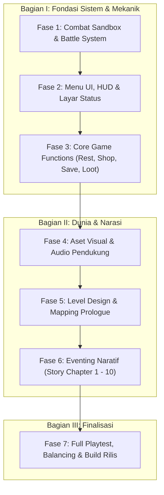

# 🗺️ Roadmap Pengembangan Game: Tales of The Dark Time (RPG Maker MV)
## Pendekatan: Systems-First & Mechanics-First

> **Prinsip Utama:** *"Matangkan sistem, pertarungan, menu, dan fungsi dasar terlebih dahulu di dalam Combat Sandbox. Setelah fondasi mekanik terasa solid dan teruji, barulah kita merangkai map, cutscene, dan alur naratif (Chapter 1–10) di atas mesin yang sudah stabil."*

---

## 📊 1. Mengapa Pendekatan *Systems-First*?

1. **Mencegah Kerja Ulang (*No Mass Rework*):** Perubahan formula stat, stamina, efek status, atau layout UI di tengah jalan tidak akan merusak puluhan cutscene atau ratusan event yang sudah dibuat.
2. **Memastikan *Game Feel* Memuaskan:** Pertarungan turn-based CTB Nusvanir harus terasa responsif, taktis, dan berdampak (*punchy*) sejak detik pertama pemain menekan tombol serang.
3. **Penyusunan Konten Menjadi Cepat & Mulus:** Ketika seluruh fungsi (toko, peti, resting, menu, battle) sudah siap pakai, pembuatan cerita tinggal memanggil event dan mekanik yang sudah terbukti bebas bug.

---

## 🧭 2. Gambaran Besar Tahapan (Pipeline)

---

## 🛠️ BAGIAN I: FONDASI SISTEM & MEKANIK

### ⚔️ Fase 1: Combat Sandbox & Battle System Stabilization
*Fokus: Menguji rasa pertarungan (combat feel), pacing CTB, action sequences, dan formula damage di ruangan tertutup.*

- [x] **1.1 Pembuatan Map Khusus Pengujian (`Dev_Combat_Sandbox`)**
  - [x] Buat 1 map kecil tertutup khusus untuk testing developer (tidak dapat diakses oleh pemain biasa).
  - [x] Pasang NPC Spawner Musuh:
    - NPC Dummy (musuh diam dengan HP tinggi untuk tes kalkulasi damage).
    - NPC Kelompok Musuh Ringan (tes ritme turn CTB 3 lawan 3).
    - NPC Bos Uji Coba (tes fase skill musuh & AI Core).
  - [x] Pasang NPC Full Heal (pemulih instan HP, MP, dan Stamina setelah battle).
- [x] **1.2 Kalibrasi CTB Battle System (`YEP_X_BattleSysCTB`)**
  - [x] Periksa kecepatan pengisian *Charge Turn Bar*:
    - Pastikan Agility (AGI) berpengaruh nyata pada urutan giliran tanpa membuat musuh terlalu sering memotong antrean secara berlebihan.
  - [x] Tampilan giliran (Turn Order Icon): Pastikan ikon wajah/nama karakter di bar antrean CTB tampak jelas dan tidak tumpang tindih.
- [ ] **1.3 Action Sequence & Dampak Serangan (*Game Feel*)**
  - [ ] Kustomisasi urutan aksi serang (`YEP_X_ActSeqPack1/2/3`) untuk karakter utama:
    - **Hector:** Gerakan melangkah maju $\to$ tebasan pedang dengan efek kilat $\to$ guncangan layar (*Screen Shake*) halus saat kena musuh.
    - **Cassian:** Posisi mengangkat tongkat $\to$ lingkaran sihir di bawah kaki $\to$ proyektil doa suci melesat ke target.
    - **Rama:** Animasi hembusan angin/aeromancy berkecepatan tinggi.
  - [x] Tipografi Vektor HD & Overhead Positioning (`NUSV_BattlePopups`):
    - Angka damage & heal melayang rapi di atas kepala battler (overhead origin), bebas overlap multi-hit (+22px cascade).
    - Menggunakan font RPG HD (`BattleFont` / `final-fantasy-advance-ds.otf`) dengan outline tegas 5px dan drop shadow pekat.
    - Palet warna jelas: Normal Damage Putih/Coral, Critical Emas (#FFD700) + Badge "CRITICAL!", Heal Zamrud (#2ECC71), Miss Perak (#E5E7EB).
    - Visual Enemy Select Nameplate dipindahkan ke atas kepala musuh (overhead dark glass pill, 38px clearance).
  - [ ] Berikan efek suara benturan (*Sound FX*) yang berbobot saat serangan mendarat.
- [ ] **1.4 Validasi Formula Stat & Efek Status (States)**
  - [ ] Uji formula pertempuran dari [`Sistem_Stat_&_Formula_Turn_Based.md`](file:///mnt/DC9EA2C29EA29494/Nusvanir_Vault/06_Sistem%20Game%20&%20Ekonomi/Sistem_Stat_&_Formula_Turn_Based.md) melalui plugin `NUSV_DamageCore` dan `damage_simulator.html`.
  - [ ] Uji efektivitas efek status utama dari [`Kamus_State_&_Status_Efek.md`](file:///mnt/DC9EA2C29EA29494/Nusvanir_Vault/06_Sistem%20Game%20&%20Ekonomi/Kamus_State_&_Status_Efek.md):
    - Status DoT (*Poison, Bleed, Burn*): Pengurangan darah per giliran.
    - Status CC (*Stun, Sleep, Terrify*): Pengecekan apakah giliran terlewati dengan benar pada sistem CTB.
    - Status Buff (*Shield, Ward, Bless*): Pengurangan persentase damage yang masuk.

---

### 🖥️ Fase 2: Menu UI, HUD & Kustomisasi Tampilan Interface
*Fokus: Memastikan pemain mendapatkan informasi status karakter dengan nyaman, taktis, dan terstandarisasi melalui arsitektur visual IconSet yang terintegrasi.*

- [ ] **2.1 Tata Letak Menu Utama & Ikon Perintah (Main Menu & Command Icons)**
  - [ ] Kustomisasi susunan opsi menu: `[Barang] [Keahlian] [Perlengkapan] [Status] [Formasi] [Pengaturan] [Simpan] [Keluar]` (`YEP_MainMenuManager`).
  - [ ] Integrasi Ikon Perintah Menu Navigasi (`\I[x]`):
    - **Item / Inventaris:** Tas ransel petualang (*backpack*) atau kantong perbekalan.
    - **Skill / Keahlian:** Buku mantra terbuka (*grimoire*) atau kilatan aura energi.
    - **Equip / Perlengkapan:** Zirah dada bersilang dengan pedang.
    - **Status:** Kartu profil / siluet kepala karakter.
    - **Class / Pohon Profesi:** Lencana lambang kelas (*crest*) atau cabang keahlian.
    - **Formation / Party (Pilihan Aset Atlas `database/pixel_art_atlas/unique_icons_32x32/`):**
      - *Opsi Roster Karakter (Teks 'Party'):* `person.png` (siluet petualang klasik) atau `knight helmet.png` (ksatria bertaring).
      - *Opsi Mekanikal Barisan (Teks 'Formation'):* `circular arrows icon.png` (dua panah rotasi swap giliran) atau `chess pawn.png` (bidak catur taktis).
      - *Opsi Pasukan Gilda:* `war banner.png` / `heraldic banner.png` (panji perang militer).
    - **Quest Journal:** Buku catatan jurnal misi bertinta bulu ayam.
    - **Options:** Roda gigi mekanikal (*gear/cogwheel*).
    - **Save / Simpan:** Buku catatan bersinar rune (`Saved Icon: 231`) vs buku kosong (`Empty Icon: 230`).
    - **Game End:** Pintu gerbang keluar benteng.
  - [ ] Standardisasi mata uang resmi: **Koin Saka** (`Gold Icon: 313`) menggantikan simbol Gold standar.
  - [ ] Tampilkan bar status mini di jendela menu: Wajah Karakter (*Enhanced Face Crop 82%*), bar HP, MP, dan SP (Stamina Points dinamis).

- [ ] **2.2 Layar Status Karakter (Status Window Overhaul — `NUSV_StatusScreen.js`)**
  - [ ] Tata letak modern 3 kolom Genshin-style dengan visualisasi parameter lengkap Nusvanir:
    - **Resource Pools:** Max HP (Hati merah), Max MP (Kristal biru), Max SP Dinamis (Petir hijau/oranye pengganti TP).
    - **6 Base Stats Inti:**
      - *STR (Strength):* Otot bisep bersinar / kapak merah pemukul.
      - *INT (Intelligence):* Buku sihir terbuka / mata arcane biru.
      - *DEX (Dexterity):* Tangan membidik / busur bersilang presisi.
      - *AGI (Agility):* Sayap melayang / sepatu lari angin.
      - *VIT (Vitality):* Perisai perunggu / jantung berbaju zirah pelindung.
      - *LUK (Luck):* Daun semanggi / koin takdir keberuntungan.
    - **Stat Tempur Turunan & Formula:** ATK, DEF, MAT, MDF, HIT, EVA, CRI (Crit Rate), CDM (Crit Damage), Armor Penetration, Magic Penetration, dan CTB Action Speed.
    - **11 Elemen Afinitas Nusvanir:** Neutral, Fire, Water, Earth, Air, Electric, Ice, Steel, Sound, Holy, Dark.
  - [ ] Tampilan 109 Status Efek (States):
    - *Status Ailments (CC & DoT):* Death, Defend, Poison, Burn, Bleed, Paralyze, Sleep, Confuse, Curse, Stun, Slow, Freeze, Blind, Fear, Silence, Root, Vulnerable, Haste, Taunt.
    - *Penanda Taktikal Elemen:* Soaked, Shock, Petrify, Float, Marked.
    - *Universal Stat Stages:* ATK Up/Down, DEF Up/Down, MAT Up/Down, MDF Up/Down, Speed Up, Critical Focus, Evasion Up, Magic Barrier.
    - *Stance Tempur:* Berserk Mode, Dragon Stance, Shadow Mode, Avatar of Guardian, State of Nirvana, Chi Hyper-Burst, Ancestral Protection.
    - *12 Lambang Ras Nusvanir:* Pribumi, Wahanarsa, Asrivana, Avesari, Butoraksa, Garuda, Hanorok, Nagarasven, Rakshorien, Troliogoro, Dewantara, Bhuta.
  - [ ] Integrasi profil singkat karakter (biografi, ras asal, dan pasif alami).

- [ ] **2.3 Layar Perlengkapan & Inventori (`NUSV_InventoryUI.js` & `NUSV_ItemMenuCategories.js`)**
  - [ ] **7 Slot Perlengkapan Nusvanir & Placeholder Ikon:**
    - Slot 1: Primary Weapon (Pedang / Busur / Tongkat — *placeholder icon 96*)
    - Slot 2: Secondary Weapon / Offhand (Perisai / Belati Offhand / Rune Kiri — *placeholder icon 128*)
    - Slot 3: Helm (Pelindung kepala — *placeholder icon 130*)
    - Slot 4: Armor (Zirah dada — *placeholder icon 135*)
    - Slot 5: Boots (Sepatu tempur — *placeholder icon 139*)
    - Slot 6: Accessory 1 & Accessory 2 (Cincin / Amulet — *placeholder icon 144*)
    - Slot 7: Relic Universal (Artefak naga / pusaka kuno — *placeholder icon 160*)
    - Slot Lepas / Kosong: Lingkaran garis putus-putus (`Empty / Remove Icon: 16`).
  - [ ] Penegakan aturan slot: Senjata 2-Handed otomatis menyegel Slot 2 dan melepas offhand ke tas (`NUSV_EquipRules.js`).
  - [ ] **Kategori Tab Inventaris Terstruktur (`NUSV_ItemMenuCategories.js`):**
    - `Consumables:` Potion (HP), Ether (MP), Stamina Drop (SP), Elixir, Phoenix Feather, 10 Obat Penawar Status, 5 Tonik Stat Buff, Smoke Bomb.
    - `Materials:` 33 Material Crafting Tier 1–5 (Logam/Bijih, Kayu, Kulit/Sisik, Kain/Serat, Herbal/Bunga, Inti Elemental).
    - `Forge & Socket:` Kristal Soket Stat T1–T3 (STR, INT, DEX, AGI, VIT, LUK), Life/Mana/Stamina Crystals, Enhance Stones (Upgrade +1 s/d +15), Socket Chisel.
    - `Valuables:` Komoditas jual Saka (Tembaga, Perak, Emas Batangan, Permata Mentah, Relik Naga Kuno).
    - `Key Items:` 8 Dokumen Perjanjian Iblis (*Covenant*), Lencana Gilda, Kunci Reruntuhan, Peta Dunia, Memory Shard, dan 4 Grimoire Eksplorasi Map (*Lumos, Garuda's Wings, Trailblaze, Water Strider*).
  - [ ] Visualisasi Soket & Tingkat Upgrade:
    - Slot Soket Kosong `[○]` vs Terisi Permata `[●]` (`NUSV_SocketCore.js`).
    - Tingkat Penempaan Senjata (+1 s/d +15) dengan indikator visual tingkat kelangkaan (*Common, Uncommon, Rare, Epic, Legendary*).
  - [ ] Aktifkan `NUSV_AutoTextWrap.js` agar lore item panjang terbungkus rapi tanpa terpotong tepi layar.
  - [ ] Indikator komparasi stat equipment (*stat preview*: hijau naik, merah turun).

- [ ] **2.4 Menu Opsi & Pengaturan Game (`NUSV_OptionsCore`)**
  - [ ] Pengaturan volume audio independen: BGM, BGS, ME, dan SE.
  - [ ] Pengaturan kecepatan animasi tempur & battle log (Kecepatan 1–5).
  - [ ] Pilihan Slider Tingkat Kesulitan (*Difficulty Slider*: Easy, Normal, Hard, Nightmare dengan ikon daun, pedang, tengkorak perak, dan tengkorak api).
  - [ ] Fitur Auto-Dash & Koreksi Baseline Vertikal Font GameFont (`NUSV_GameFontBaseline.js`).

- [ ] **2.5 Arsitektur Master IconSet Nusvanir (Pixel Atlas Grid 16 Kolom × 32×32 px)**
  - [ ] Standardisasi kanvas Master `IconSet.png` (512×1568 px / 784 slot ikon terstruktur, dipandu oleh `NUSV_ICONSET_GUIDE.md` & `tools/curate_iconset.py`):
    - **Baris 0 – 3 (ID 0 – 63):** UI Sistem, Menu Navigasi, Command Tempur (Attack, Guard, Magic, Summon, Ultimate), Pools (HP/MP/SP), 6 Base Stats, Saka (313), Save/Load (231/230), Formasi (`person.png` / `circular arrows icon.png`).
    - **Baris 4 – 7 (ID 64 – 127):** 11 Afinitas Elemen, Proyektil Sihir, dan 10 Tipe Senjata Dasar T1–T5 (Long Sword, Sword, Gloves, Spear, Axe, Staff, Rune, Long Bow, Crossbow, Dagger).
    - **Baris 8 – 11 (ID 128 – 191):** Zirah (Clothes, Robe, Light, Heavy), Perisai (Light/Heavy), Pelindung Kepala, Sepatu Bot, Aksesori, Relik & Placeholder Slot Kosong.
    - **Baris 12 – 16 (ID 192 – 271):** Consumables (Pemulih, 10 Penawar Ailment, 5 Tonik Stat), 4 Grimoire Eksplorasi, dan Quest Journal Icons.
    - **Baris 17 – 22 (ID 272 – 367):** 33 Material Crafting Resep (Logam, Kayu, Kulit, Kain, Herbal, Inti Elemen) & Valuables (Koin/Permata Saka).
    - **Baris 23 – 27 (ID 368 – 447):** Forge & Socket (Kristal Permata T1–T3, Batu Upgrade +1–+15, Socket Chisel).
    - **Baris 28 – 34 (ID 448 – 559):** 109 States Kanonikal (Status Ailments CC/DoT, +/- Stat Stages, Stances, Lambang 12 Ras Nusvanir).
    - **Baris 35 – 45 (ID 560 – 735):** Skill Tempur Kelas (Serangan Fisik, Mantra Elemental, Penyembuhan, Pasif Kelas, dan Finisher).
    - **Baris 46+ (ID 736 – 783):** Emblem 50 Kelas Profesi (Tier 1 s/d Tier 5) & Key Items Khusus (8 Perjanjian Iblis, Kunci Ruin).
  - [ ] Pemanfaatan katalog sumber daya lokal 6.194 ikon di `database/pixel_art_atlas/unique_icons_32x32/` dan kurasi visual interaktif melalui `tools/nusv_iconset_picker.html`.

---

### 📦 Fase 3: Fungsi-Fungsi Dasar Dunia (Core Gameplay Loop)
*Fokus: Membangun mekanisme interaksi dunia sebelum petualangan dimulai.*

- [ ] **3.1 Sistem Istirahat & Pemulihan (Resting Mechanics)**
  - [ ] **Sistem Penginapan (Inn / Tavern):** Event pembayaran koin Saka untuk memulihkan seluruh party disertai jingle tidur singkat dan transisi layar gelap.
  - [ ] **Sistem Api Unggun / Perkemahan (Campfire / Rest Spot):** Lokasi istirahat di alam liar (Thalantira/Perjalanan) dengan batasan resource (misal: butuh kayu bakar atau ransum).
- [ ] **3.2 Sistem Ekonomi & Transaksi Toko (Shop System)**
  - [ ] Standardisasi format jendela toko jual-beli perlengkapan dan consumable.
  - [ ] Uji coba rasio jual: Harga jual barang bekas sejalan dengan rasio ekonomi Nusvanir (misal: 40–50% dari harga beli).
- [ ] **3.3 Sistem Interaksi Lingkungan Standar (Common Interactive Objects)**
  - [ ] **Peti Harta Karun (Treasure Chest):** Template event peti dengan animasi buka, suara engsel, dan notifikasi perolehan item.
  - [ ] **Pintu & Gerbang Terkunci:** Mekanisme pengecekan kunci item di inventori sebelum pintu terbuka.
  - [ ] **Batu Monumen / Pustaka (Readable Lore Objects):** Jendela teks khusus untuk membaca catatan purba atau arsip tanpa mengganggu pergerakan pemain.
- [ ] **3.4 Mekanisme Level-Up & Progresi Skill**
  - [ ] Pesan notifikasi saat karakter naik level (*Level Up Notification*).
  - [ ] Pengecekan otomatis terbukanya skill baru sesuai kurva level kelas masing-masing karakter.
- [ ] **3.5 Sistem Penyimpanan Permainan (Save/Load System)**
  - [ ] Penentuan aturan save: Apakah pemain bisa *Save Anywhere* atau hanya di *Save Point* khusus / penginapan (untuk menambah nuansa survival dark fantasy).
  - [ ] Uji coba load save data untuk memastikan tidak ada variabel yang hilang atau reset saat memuat permainan.

---

## 🎨 BAGIAN II: DUNIA, ASET & NARASI

### 🎭 Fase 4: Pengadaan Aset Visual & Audio Pendukung
*Fokus: Menyiapkan materi visual dan pendengaran untuk membangun atmosfer panggung cerita.*

- [ ] **4.1 Sprite & Portrait Karakter Kunci**
  - [ ] Sprite jalanan & SV Battler untuk **Rama** (The Aeromancer).
  - [ ] Sprite overworld untuk NPC penting Avalerion: **Sage Luna**, **Komandan Darius**, **High Priest**.
  - [ ] Face portrait & ekspresi dialog untuk entitas iblis **Mamon**.
  - [ ] Desain visual untuk wujud manusia penjaga kuil:
    - Wanita bergaun air (**Hydra Jurang**).
    - Pria paruh baya bertubuh tambun (**Behemoth Cangkang Hitam**).
- [ ] **4.2 Sound FX & BGM Dark Fantasy**
  - [ ] BGM Agung Kastil Avalerion.
  - [ ] BGM Melankolis Kota Pelabuhan Aqualis.
  - [ ] BGS Gemuruh Ombak & Badai Petir Rangkaruna.
  - [ ] BGM Misteri Hening Pulau Thalantira.
  - [ ] BGM Pertarungan Bos Menegangkan (Mamon & Penjaga Kuil).

---

### 🗺️ Fase 5: Level Design & Mapping Area Prologue
*Fokus: Menggambar seluruh lokasi kejadian dari Bab 1 hingga Bab 10.*

- [ ] **5.1 Area Perkotaan & Kastil**
  - [ ] Lengkapi detail **Kota Pelabuhan Aqualis (Map 018):** Area dermaga kapal Rama, pasar ikan, kedai minum (*tavern*), dan pos garnisun.
  - [ ] Finalisasi interior dan eksterior **Kastil Avalerion** (ruang tahta, ruang riset kristal, balkon).
- [ ] **5.2 Area Bahari & Alam Liar**
  - [ ] Peta Dek Kapal Nelayan Rama (Versi laut tenang).
  - [ ] Peta Dek Kapal Nelayan Rama (Versi diterjang badai ganas Rangkaruna).
- [ ] **5.3 Area Pulau Terlarang Thalantira (Śaptadvīpa)**
  - [ ] Peta Pesisir Pantai Pendaratan & Hutan Primordial Pohon Asing.
  - [ ] Peta Pintu Gerbang Purba (dengan monumen peta batu abstrak dan 3 lubang kunci lingkaran).
  - [ ] Peta **Kuil Air (Timur):** Waduk raksasa bawah tanah & gua kristal es sarang **Hydra Jurang**.
  - [ ] Peta **Kuil Tanah (Barat):** Labirin bebatuan gersang kediaman **Behemoth Cangkang Hitam**.
  - [ ] Peta **Kuil Udara (Utara):** Puncak gunung api purba bermagma ungu sarang **Void Wyrm**.
  - [ ] Peta Ruang Segel Inti (*Void Crystal Chamber*) tempat tertidurnya kesadaran Uru.

---

### 📖 Fase 6: Eventing Naratif (Story Chapter 1 – 10)
*Fokus: Merangkai dialog, cutscene kamera, perpindahan map, dan trigger pertarungan cerita.*

- [ ] **6.1 Babak I: Perintah Rahasia & Pertemuan di Aqualis (Bab 1 – 3)**
  - [ ] *Ch 1 & 2:* Pertemuan rahasia Cassian & Hector di Avalerion; keputusan membelot demi mengungkap kitab purba *The Old Tale*.
  - [ ] *Ch 3:* Tiba di Aqualis; merekrut Rama di kedai minum untuk menembus batas badai laut.
- [ ] **6.2 Babak II: Menembus Badai Rangkaruna (Bab 4 – 6)**
  - [ ] *Ch 4:* Rama mengendalikan angin (Aeromancy) membelah ombak raksasa; cutscene dramatis di atas geladak kapal.
  - [ ] *Ch 5 & 6:* Pendaratan di Thalantira; Hector memanggil sayap cahaya *(Avatar of Guardian: Garuda)* melompati benteng karang mematikan; keanehan ekosistem pulau yang terlampau hening.
- [ ] **6.3 Babak III: Ujian Tiga Kuil Penjaga (Bab 7 – 8)**
  - [ ] *Ch 7:* Cassian memecahkan peta purba; ekspedisi ke Kuil Air dan pertemuan mengejutkan dengan wanita jelmaan **Hydra Jurang** yang menyerahkan *Emblem Air* tanpa kekerasan.
  - [ ] *Ch 8:* Perjalanan ke Kuil Tanah; pertarungan singkat melawan **Behemoth Cangkang Hitam** sebelum monster itu melunak dan berubah wujud menjadi pria ramah; letusan magma ungu di gunung utara.
- [ ] **6.4 Babak IV: Pecahnya Segel & Tragedi Aqualis (Bab 9 – 10)**
  - [ ] *Ch 9:* Pemasangan ketiga emblem ke gerbang batu; terbukanya rahasia kosmik Uru dan Sang Hyang Cahaya.
  - [ ] *Ch 10:* Guncangan dahsyat; manifestasi iblis **Mamon** membakar pelabuhan Aqualis; pertarungan klimaks hidup-mati; pengorbanan heroik Rama; vonis pengasingan Hector & Cassian; serta pemisahan bayi kembar (Hiro & Damian).

---

## 🏆 BAGIAN III: FINALISASI & PACKAGING

### 🧪 Fase 7: Full Playtest, Balancing & Build Distribusi
*Fokus: Memastikan produk game berkualitas tinggi, stabil, dan siap dimainkan publik.*

- [ ] **7.1 Full Playthrough End-to-End**
  - [ ] Mainkan game dari awal New Game hingga Roll Credits tanpa menyentuh menu debug atau cheat.
  - [ ] Catat setiap kejanggalan: dialog typo, arah hadap karakter yang salah, musik yang terpotong, atau pertempuran yang terlalu sulit/mudah.
- [ ] **7.2 Kurva Balancing Tingkat Kesulitan**
  - [ ] Pastikan bos kuil dan bos final Mamon memberikan tantangan taktis yang adil.
  - [ ] Pastikan suplai potion dan mana cukup untuk bertahan hidup di Thalantira.
- [ ] **7.3 Export Standalone Windows Build**
  - [ ] Gunakan fitur *Deployment* RPG Maker MV (Windows Desktop).
  - [ ] Hapus aset grafis/audio bawaan yang tidak terpakai untuk memperkecil ukuran installer (*clean build*).
  - [ ] Buat file `README_UNTUK_PEMAIN.md` berisi kontrol keyboard/gamepad dan sinopsis.

---

## 🎯 Target Langkah Pertama Anda (Hari Ini)

Fokuskan energi Anda pada **3 tugas teknis ini terlebih dahulu**:

1. **Buka RPG Maker MV dan buat map baru bernama `Dev_Combat_Sandbox` (Ukuran 20x15).**
2. **Pasang 1 event musuh uji coba (Dummy Enemy) di map tersebut.**
3. **Mulai battle test untuk merasakan tempo CTB dan kelancaran animasi serang Cassian & Hector.**
