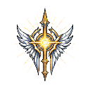

# ⚔️ Tales of The Dark Time

<p align="center">
  
</p>

<p align="center">
  <strong>Sebuah Game RPG Berbasis Giliran (Turn-Based RPG) dalam Semesta Fantasi Nusvanir</strong>
</p>

<p align="center">
  
  
  
  
</p>

---

## 📖 Daftar Isi

1. [Tentang Game](#-tentang-game)
2. [Fitur &amp; Sistem Permainan](#-fitur--sistem-permainan)
3. [Karakter Utama](#-karakter-utama)
4. [Alat Pengembangan: NUSV Database Studio](#-alat-pengembangan-nusv-database-studio)
5. [Cara Menjalankan Game](#-cara-menjalankan-game)
6. [Struktur Direktori Proyek](#-struktur-direktori-proyek)
7. [Log &amp; Roadmap Pengembangan](#-log--roadmap-pengembangan)
8. [Lisensi &amp; Kredit](#-lisensi--kredit)

---

## 🌌 Tentang Game

**Tales of The Dark Time** adalah permainan peran klasik (Turn-Based RPG) yang dibangun di atas mesin RPG Maker MV dengan fondasi world-building orisinal **Nusvanir**. Game ini mengajak pemain menjelajahi daratan Nusvanir yang sarat misteri, reruntuhan kuno, konflik kerajaan, dan ancaman kegelapan yang bangkit kembali.

Di dunia ini, ekonomi digerakkan oleh mata uang **Saka**, pertarungan memanfaatkan perpaduan sihir elemental (Elemen Netral, Api, Air, Tanah, Angin, Listrik, Es, Baja, dan Suara), serta sistem atribut mendalam yang membedakan setiap pahlawan.

---

## ⚡ Fitur & Sistem Permainan

### 1. Dual-Level Progression System
Game ini memisahkan tingkat pertumbuhan karakter menjadi dua jalur progresif:
- **Base Level (Lv 1 - 99):** Tingkat kematangan fisik karakter yang mempengaruhi atribut bawaan spesies, ketahanan fisik, dan kapasitas HP/MP.
- **Class / Job Level:** Tingkat kemahiran profesi yang memiliki batas maksimal sesuai tingkatan Tier kelas (misal: Tier 1 maks Lv 10, Tier 2 maks Lv 30, dst.). Peningkatan Job Level membuka skill baru dan bonus IV scaling atribut profesi.

### 2. Sistem 6 Core Attributes & Stat Tempur Terpadu
Setiap karakter dan musuh memiliki 6 atribut inti yang menentukan parameter tempur turunan:
- **STR (Strength):** Meningkatkan Physical ATK (P.ATK), sedikit Max HP, dan P.DEF.
- **INT (Intelligence):** Meningkatkan Magic ATK (M.ATK), Magic DEF (M.DEF), Max MP, dan regenerasi MP per giliran.
- **VIT (Vitality):** Menentukan daya tahan tubuh, Max HP utama, P.DEF, dan efisiensi Guard (GRD).
- **AGI (Agility):** Menentukan inisiatif kecepatan giliran (Speed) dan peluang menghindar (EVA).
- **DEX (Dexterity):** Mempengaruhi akurasi serangan (HIT Rate), Critical Rate (CRI), dan senjata tipe *Finesse* (Belati/Busur).
- **LUK (Luck):** Mempengaruhi keberuntungan menjatuhkan item, peluang kritikal, dan resistensi terhadap efek status buruk.
- **SP Stamina System:** Menggantikan sistem TP default dengan sistem stamina tempur yang dapat pulih tiap giliran berdasarkan VIT & AGI.

### 3. Tiered Class & Skill Trees
- Kelas karakter terbagi ke dalam **6 Tier Profesi** (*Tier 1 Base/Novice, Tier 2 Advanced, Tier 3 Elite, Tier 4 Master, Tier 5 Grandmaster, dan Tier 6 Pinnacle*).
- Setiap kelas memiliki daftar keahlian (*Learnings*) yang terbuka secara bertahap seiring naiknya Job Level.

### 4. Sistem Perlengkapan & Equipment Taktis
- **Aturan Slot Senjata:** Mendukung *1-Handed (1H)*, *2-Handed (2H - Mengunci slot offhand)*, dan *Dual-compatible*.
- **Tingkatan Rarity:** Common, Uncommon, Rare, Epic, Legendary, dan Mythic.
- **Gem Sockets & Upgrade:** Senjata dan zirah mendukung slot soket batu permata dan peningkatan daya serang (+ATK/+MAT).
- **Unleash Skill & Item Sets:** Kemungkinan memicu skill khusus saat menyerang dan bonus set jika mengenakan kombinasi perlengkapan tertentu.

### 5. Resep & Crafting (Synthesis)
Sistem kerajinan untuk menciptakan item konsumsi, ramuan alkimia, bahan tempa (*Forge*), dan masakan (*Cooking*).

---

## 👥 Karakter Utama

| Karakter | Peran / Deskripsi Awal | Kelas Utama |
| :--- | :--- | :--- |
| **Cassian** | Protagonis utama petualang muda yang terikat dengan misteri era kegelapan. | Fighter / Warrior |
| **Hector** | Pendekar berpengalaman bertameng kokoh dan ahli dalam pertahanan baris depan. | Knight / Defender |
| **Jane** | Ahli strategi dan perapal mantra yang menguasai sihir alam semesta. | Apprentice / Mage |
| **Rama** | Pengintai lincah dengan keahlian serangan presisi dan belati cepat. | Scout / Ranger |

---

## 🛠️ Alat Pengembangan: NUSV Database Studio

Proyek ini dilengkapi dengan aplikasi editor internal kustom **NUSV Database Studio** yang dirancang khusus untuk mempermudah perancangan data game tanpa batasan antarmuka bawaan engine.

```
📁 editor_studio/
├── 📁 css/              # Styling tema antarmuka dark mode
├── 📁 js/
│   ├── 📁 editors/      # Modul editor per entitas (Actor, Class, Weapon, Armor, Skill, Item, Enemy, State)
│   ├── 📁 modals/       # Visual IconSet picker, Traits modal, Effects modal, EXP curves simulator
│   ├── api.js           # REST API client ke backend Python
│   ├── constants.js     # Definisi rumus stat, formula RPG, dan kategori NUSV
│   ├── state.js         # Pengelola state aplikasi & unsaved changes
│   ├── ui.js            # Render antarmuka, dropdown filter, dan navigasi tab
│   └── utils.js         # Parser tag notetag RPG Maker & formatting
└── index.html           # File entry visual studio
```

### Keunggulan Studio:
- **Dedicated Desktop Window:** Dapat dijalankan sebagai aplikasi desktop tersendiri di Windows & Linux Mint.
- **Dropdown Multi-Filter:** Filter instan untuk Tipe Senjata, Slot Armor, Tier Kelas, Profesi Skill, Kategori Item, dan Klasifikasi State (*Passive, Status Effect, Skill Effect*).
- **Visual Icon Picker:** Pemilihan ikon 32×32 langsung dari berkas `IconSet.png` game.
- **Dual-Level Simulator:** Pratinjau langsung stat akhir karakter pada kombinasi Base Level dan Job Level tertentu.
- **Tooltip Formula Interaktif:** Arahkan kursor mouse ke nama stat untuk melihat penjelasan bahasa Indonesia dan rumus matematika lengkapnya.
- **Auto-Backup:** Setiap penyimpanan secara otomatis membuat salinan cadangan JSON di `data/backups/`.

### Menjalankan Studio:
- **Windows:** Double-click `NUSV_Database_Studio.bat` atau ketik `./tools/create_desktop_shortcut.bat` untuk membuat shortcut di Desktop.
- **Linux Mint / Ubuntu:** Jalankan `./NUSV_Database_Studio.sh` di terminal atau gunakan launcher `NUSV_Database_Studio.desktop`.
- **Mode Web Browser:** Jalankan backend server:
  ```bash
  python tools/nusv_editor_server.py
  ```
  Lalu buka tautan [http://localhost:5050](http://localhost:5050) di browser.

---

## 🎮 Cara Menjalankan Game

### Kebutuhan Sistem:
- **OS:** Windows 7 / 8 / 10 / 11 atau Linux (via Wine / NW.js native)
- **Prosesor:** Intel Core 2 Duo atau yang setara
- **RAM:** Minimal 4 GB (disarankan 8 GB)
- **Penyimpanan:** Minimal 1 GB ruang kosong

### Langkah Menjalankan:
1. Pastikan seluruh file repositori sudah terunduh / ter-clone.
2. Di **Windows**, jalankan file:
   ```bash
   Game.exe
   ```
3. Di **Linux / MacOS**, Anda dapat menjalankan `index.html` menggunakan `nw` (NW.js runtime) atau melalui emulator Wine.

---

## 📂 Struktur Direktori Proyek

```
Tales of The Dark Time/
├── 📁 audio/                    # Berkas BGM, BGS, ME, dan SE permainan
├── 📁 data/                     # Berkas JSON database RPG Maker MV
│   └── 📁 backups/              # Cadangan otomatis database dari Studio
├── 📁 fonts/                    # Font tipografi game
├── 📁 icon/                     # Ikon aplikasi
├── 📁 img/                      # Seluruh aset grafis (Characters, Enemies, SV Battlers, Pictures, Tilesets)
├── 📁 js/                       # Core engine RPG Maker MV & Plugins (Yanfly, NUSV Plugins, dll.)
├── 📁 editor_studio/            # Sumber kode modular NUSV Database Studio
├── 📁 tools/                    # Skrip pembantu (Server backend, Bundler, Verifier)
├── 📄 Game.exe                  # Eksekutor utama game (Windows)
├── 📄 index.html                # Entry point game webkit
├── 📄 package.json              # Konfigurasi jendela & runtime game
├── 📄 editor.html               # Entry point NUSV Database Studio
├── 📄 editor.bundled.html       # Versi mandiri all-in-one studio
├── 📄 NUSV_Database_Studio.bat  # Launcher Desktop Studio (Windows)
├── 📄 NUSV_Database_Studio.sh   # Launcher Desktop Studio (Linux)
└── 📄 README.md                 # Dokumentasi proyek
```

---

## 📝 Log & Roadmap Pengembangan

### Log Terkini:
- [x] Perancangan World Map awal dan eksterior benua Avalerion.
- [x] Integrasi sistem Sideview Battle dengan battler hero kustom.
- [x] Implementasi 6 Core Attributes (STR, INT, VIT, AGI, DEX, LUK) dan sistem regenerasi SP Stamina.
- [x] Pengembangan dan modularisasi **NUSV Database Studio v3.0** (Web & Desktop).
- [x] Sistem klasifikasi State terpadu (*Passive, Status Effect, Skill Effect*).
- [x] Penambahan filter dropdown per tier kelas, kategori item, tipe senjata, dan slot zirah.

### Rencana Selanjutnya (To-Do):
- [ ] Pembuatan sprite overworld untuk karakter Rama, Sage Luna, Darius, dan High Priest.
- [ ] Perancangan portrait ekspresi wajah untuk karakter Mamon.
- [ ] Pemetaan dan implementasi area perkotaan baru: **Aqualis City**.
- [ ] Balancing kurva pertumbuhan atribut profesi Tier 2 dan Tier 3.
- [ ] Pengisian narasi prolog dan rangkaian quest pembuka di Avalerion.

---

## 📜 Lisensi & Kredit

- **World Building & Lore:** Nusvanir Universe
- **Pengembang:** Ultoid Game Studio
- **Engine:** RPG Maker MV © Gotcha Gotcha Games Inc. / KADOKAWA
- Seluruh aset grafis, cerita, dan naskah merupakan hak cipta proyek *Tales of The Dark Time*.
